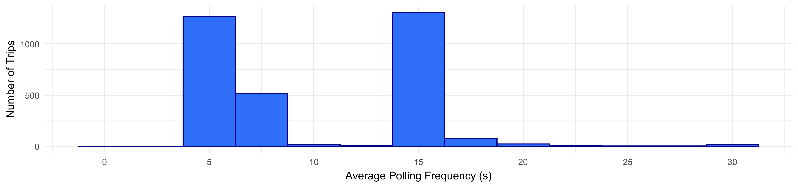
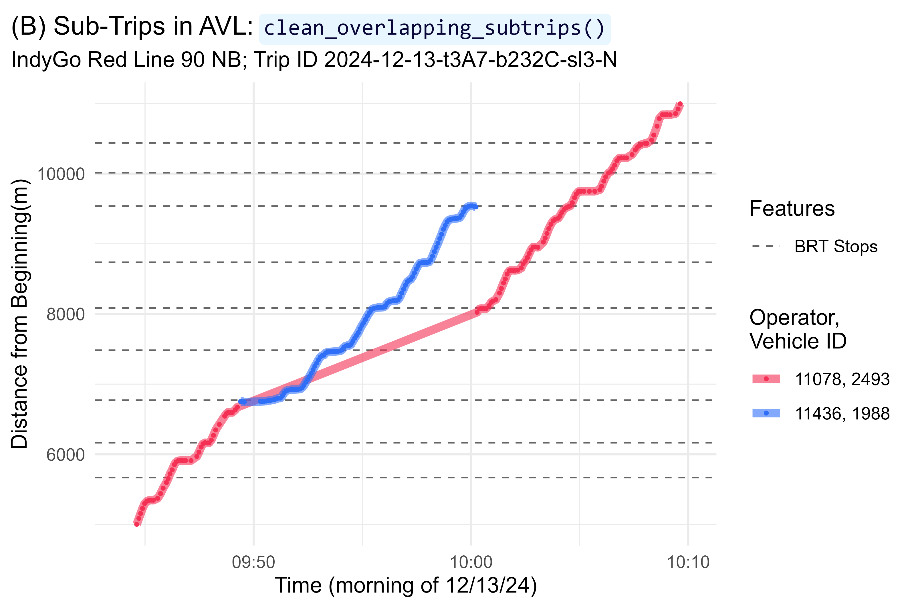
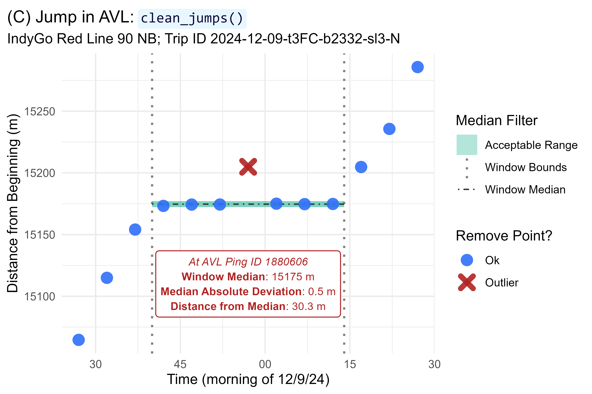
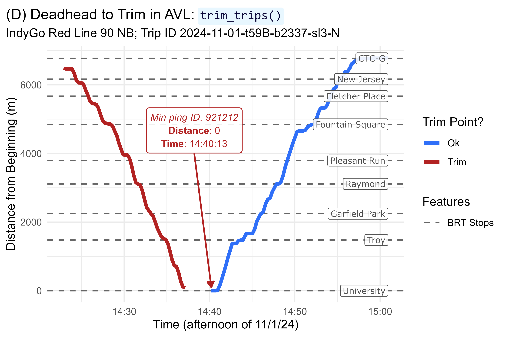
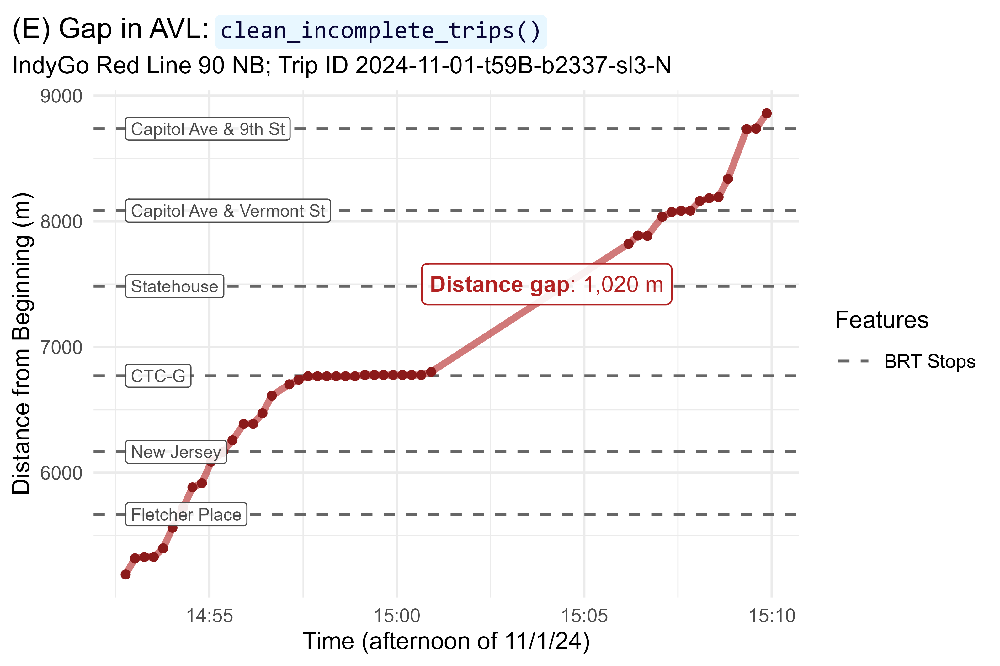
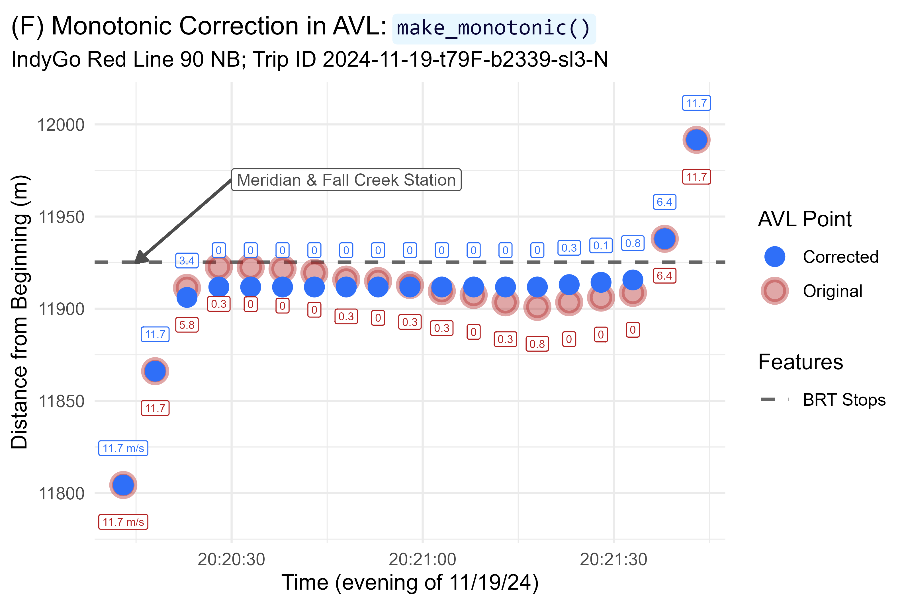
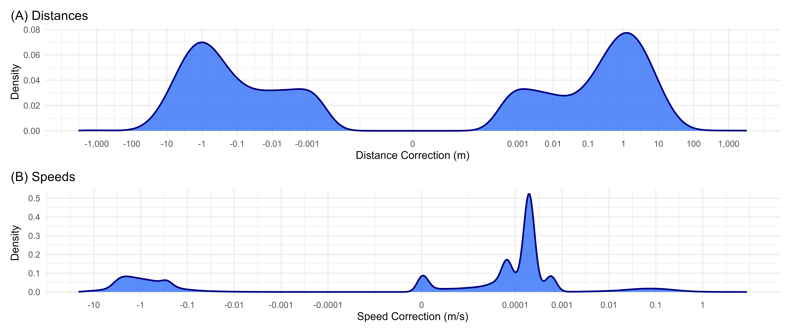
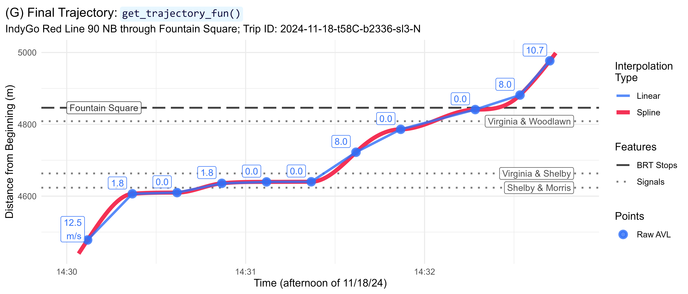
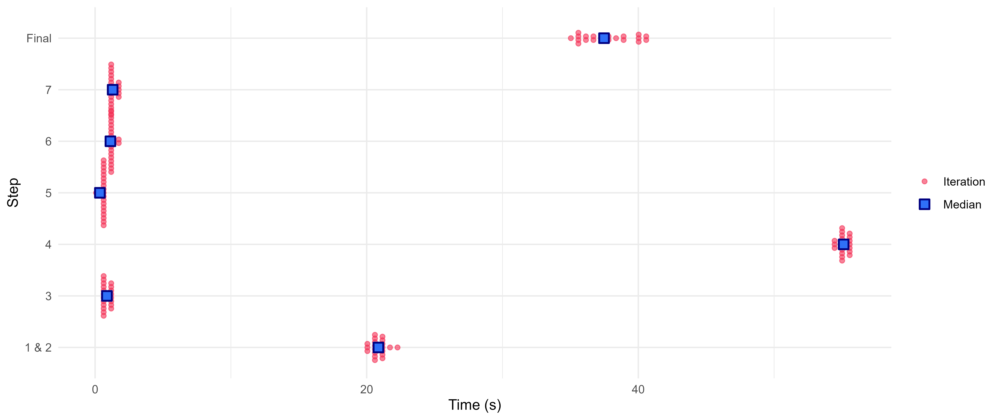

# Introduction

This vignette contains all code use to clean and visualize the AVL data presented in our Journal of Public Transportation paper. This demonstrates the application of the workflow and provides a rough estimate of the package's efficiency by tracking the computation time of each step. We ran this code on a typical consumer laptop (HP Spectre x360, with a 14-core 12th-gen Core i7-12700H and 16 GB of RAM).

This vignette is intended to complement our paper. Check out the full paper or the [package website](https://utel-uiuc.github.io/transittraj/articles/data-workflow-la.html) for a more thorough discussion of these cleaning steps. You can check out the raw, un-knit `Rmarkdown` code [here](raw-cleaning.Rmd).

# Data

The data we used here was shared with us privately by IndyGo
via their Swiftly API endpoint. As such, we unfortunately cannot share the
raw data. We've pre-loaded the following IndyGo data into our RStudio
workspace before running this vignette:

  - `avl_df`: The TIDES-compliant `vehicle_locations.csv` table of historic AVL data. This includes all northbound Red Line (90N) trips made on weekdays in September and November 2024.

  - `route_geom`: The Red Line's northbound alignment, as retrieved from IndyGo's GTFS via `transittraj::get_shape_geometry()`.

With this, we can load the packages we'll need:


``` r
# For analysis
library(transittraj)
library(tidyverse)

# For plotting
library(marquee)
library(patchwork)
library(ggbeeswarm)
library(scales)
```

Next, we'll set some parameters for our visualizations:


``` r
# colors
my_r <- "#f43155"
my_b <- "#2f6ff8"
my_g <- "#00A884"

# marquee
code_style <- classic_style(code_font = "Consolas") %>%
  modify_style(tag = "code",
               background = "#e8f7ff",
               color = "#0a0738"
  )
marquee_label <- function(border = "firebrick") {
  
  lab <- classic_style(
    margin = trbl(0),
    padding = trbl(4),
    border = border,
    border_width = trbl(1),
    border_radius = 3,
    align = "center"
  )
  return(lab)
}
```

And we can set the parameters we'll use for our data cleaning. Throughout the cleaning process, we'll reference these names variables, rather than using numeric values.


``` r
# - Cleaning parameters -
indy_crs <- 32616 # WGS 84 UTM Zone 16N
route_buffer = 50 # meters
min_dist = 200 # meters
min_dur = 90 # seconds
dist_error = 0.001 # meters
max_d_gap = 800 # meters
hampel_t = 3

# - Benchmark parameters -
bench_iter <- 20
```


We'll begin by quickly exploring the average polling frequencies by each trip. Below we calculate the after polling frequency by trip, then plot a histogram of the trip-wide average frequencies.


``` r
# Get initial dims
n_obs <- dim(avl_df)[1]
n_trips <- length(unique(avl_df$trip_id_performed))
dur <- list() # for individual step median durations
bm <- list() # for full benchmarking results
bm_times <- list() # for benchmarking individual iteration times

# Polling
bin_width <- 2.5 # sec
bin_cap <- 30 # sec
polling <- avl_df %>%
  group_by(trip_id_performed) %>%
  summarize(t_0 = min(event_timestamp),
            t_f = max(event_timestamp),
            n_obs = n()) %>%
  mutate(dur = as.numeric(difftime(t_f, t_0, units = "secs")),
         avg_freq = dur / n_obs,
         freq_capped = if_else(condition = avg_freq >= bin_cap,
                               true = bin_cap,
                               false = avg_freq))
```


``` r
# Plot polling frequencies
polling_hist <- ggplot(data = polling) +
  geom_histogram(aes(x = freq_capped),
                 fill = my_b, color = "navy",
                 binwidth = bin_width) +
  theme_minimal() +
  scale_x_continuous(breaks = seq(from = 0, to = bin_cap, by = 5),
                     labels = seq(from = 0, to = bin_cap, by = 5)) +
  labs(x = "Average Polling Frequency (s)",
       y = "Number of Trips")
polling_hist
```




# Proposed Workflow

The following sub-sections present each step of the proposed workflow. These steps are more thoroughly described in our paper. To evaluate the processing time required for each step, we wrap each function in `bench::mark()` and pass additional parameters relevant to the benchmark; some cleaner code, without the additional benchmarking, is available on the [package website](https://utel-uiuc.github.io/transittraj/articles/data-workflow-la.html).

At each step, we also record the number of points and trips removed. Finally, we show the code used to generate each example visualization found in the paper, though because the figures have already been generated, we do not run these chunks when rendering the vignette. To see all un-rendered chunks, check out the [raw vignette](raw-cleaning.rmd).

## Steps 1 & 2: Buffer & Project onto Route

Steps 1 and 2 share the same function, `get_linear_distances()`, as they both require spatial analyses using the `geos` package under the hood. We'll begin by running these steps:


``` r
# - Step 1 & 2: Buffer & Linearize -
steps12 <- bench::mark(
  # transittraj
  steps12 = get_linear_distances(avl_df = avl_df,
                                 shape_geometry = route_geom,
                                 clip_buffer = route_buffer,
                                 project_crs = indy_crs),
  # benchmark
  time_unit = "s", check = TRUE, iterations = bench_iter, min_time = Inf
)
#> Warning: Some expressions had a GC in every iteration; so filtering is disabled.

# Benchmarking
distance_df <- steps12$result[[1]] %>% filter(distance < 20500)
dur[["1 & 2"]] <- steps12[,1:8]
bm[["1 & 2"]] <- data.frame(
  min_t = steps12$min,
  med_t = steps12$median,
  mem_alloc = as.character(steps12$mem_alloc),
  ngc = steps12$n_gc
)
bm_times[["1 & 2"]] <- data.frame(
  t = as.numeric(steps12$time[[1]])
)

# Save changes
n_obs <- append(n_obs,
                dim(distance_df)[1])
n_trips <- append(n_trips,
                  length(unique(distance_df$trip_id_performed)))
```

## Step 3: Remove Overlapping Subtrips

First, run the step:


``` r
# - Step 3: Remove Overlap Subtrips -
step3 <- bench::mark(
  # transittraj
  step3 = clean_overlapping_subtrips(distance_df = distance_df,
                                     check_operator = TRUE,
                                     return_removals = FALSE),
  # benchmark
  time_unit = "s", check = TRUE, iterations = bench_iter, min_time = Inf
)
#> Warning: Some expressions had a GC in every iteration; so filtering is disabled.

# Benchmarking
step3_df <- step3$result[[1]]
dur[["3"]] <- step3[,1:8]
bm[["3"]] <- data.frame(
  min_t = step3$min,
  med_t = step3$median,
  mem_alloc = as.character(step3$mem_alloc),
  ngc = step3$n_gc
)
bm_times[["3"]] <- data.frame(
  t = as.numeric(step3$time[[1]])
)

# Save changes
n_obs <- append(n_obs,
                dim(step3_df)[1])
n_trips <- append(n_trips,
                  length(unique(step3_df$trip_id_performed)))
```

Next, plot our example:


``` r
plot_trip <- "2024-12-13-t3A7-b232C-sl3-N"
plot_df <- distance_df %>%
  filter(trip_id_performed == plot_trip) %>%
  mutate(subtrip_id = paste(trip_id_performed, operator_id, vehicle_id,
                            sep = "-"),
         op_veh = paste(operator_id, vehicle_id, sep = ", "))

step3_plot <- ggplot(data = plot_df) +
  geom_hline(data = stops,
             aes(yintercept = distance, linetype = "BRT Stops"),
             color = "grey40", linewidth = 0.4) +
  geom_line(aes(x = event_timestamp, y = distance, color = op_veh),
            linewidth = 2, alpha = 0.6) +
  geom_point(aes(x = event_timestamp, y = distance, color = op_veh),
            size = 0.5, alpha = 1) +
  scale_color_manual(name = "Operator,\nVehicle ID",
                     values = c("11078, 2493" = "#f43155",
                                "11436, 1988" = "#2f6ff8")) +
  scale_linetype_manual(name = "Features",
                        values = c("BRT Stops" = "dashed")) +
  ylim(c(5000, 11000)) +
  xlim(c(as.POSIXct("2024-12-13 09:44:00", tz = "America/New_York"),
         as.POSIXct("2024-12-13 10:10:00", tz = "America/New_York"))) +
  theme_minimal() +
  labs(x = "Time (morning of 12/13/24)",
       y = "Distance from Beginning(m)",
       title = "(B) Sub-Trips in AVL: `clean_overlapping_subtrips()`",
       subtitle = paste("IndyGo Red Line 90 NB; Trip ID ", plot_trip,
                        sep = "")) +
  theme(plot.title = element_marquee(style = code_style),
        plot.title.position = "plot")
step3_plot
```




## Step 4: Remove Outlying Jumps

First, run the step:


``` r
# - Step 4: Remove jumps -
step4 <- bench::mark(
  # transittraj
  step4 = clean_jumps(distance_df = step3_df,
                      t_cutoff = hampel_t),
  # benchmark
  time_unit = "s", check = TRUE, iterations = bench_iter, min_time = Inf
)
#> Warning: Some expressions had a GC in every iteration; so filtering is disabled.

# Benchmarking
step4_df <- step4$result[[1]]
dur[["4"]] <- step4[,1:8]
bm[["4"]] <- data.frame(
  min_t = step4$min,
  med_t = step4$median,
  mem_alloc = as.character(step4$mem_alloc),
  ngc = step4$n_gc
)
bm_times[["4"]] <- data.frame(
  t = as.numeric(step4$time[[1]])
)

# Save changes
n_obs <- append(n_obs,
                dim(step4_df)[1])
n_trips <- append(n_trips,
                  length(unique(step4_df$trip_id_performed)))
```

Next, plot our example:


``` r
outliers <- clean_jumps(distance_df = step3_df,
                        t_cutoff = hampel_t,
                        return_removals = TRUE)
plot_trip <- "2024-12-09-t3FC-b2332-sl3-N"
plot_df <- step3_df %>%
  filter(trip_id_performed == plot_trip) %>%
  filter((distance >= 15050) & (distance <= 15300)) %>%
  select(event_timestamp, distance, location_ping_id, speed) %>%
  mutate(point_ok = if_else(condition =
                              (location_ping_id %in% outliers$location_ping_id),
                            true = "Outlier",
                            false = "Ok"))
window_bounds <- data.frame(x = c(as.POSIXct("2024-12-09 11:04:40",
                                             tz = "America/New_York"),
                                  as.POSIXct("2024-12-09 11:05:14",
                                             tz = "America/New_York")),
                            med = c(15174.67, 15174.67)) %>%
  mutate(upr = med + (hampel_t * 0.535 * 1.48),
         lwr = med - (hampel_t * 0.535 * 1.48))
lab_df <- data.frame(y = 15110,
                     x = mean(window_bounds$x),
                     lab = paste("*At AVL Ping ID 1880606*",
                                 "**Window Median**: 15175 m",
                                 "**Median Absolute Deviation**: 0.5 m",
                                 "**Distance from Median**: 30.3 m",
                                 sep = "  \n"))
step4_plot <- ggplot(data = plot_df) +
  geom_vline(data = window_bounds,
             aes(xintercept = x, linetype = "Window Bounds"),
             color = "grey50", linewidth = 0.8) +
  geom_rect(data = window_bounds,
            aes(xmin = x[1], xmax = x[2],
                ymin = lwr[1], ymax = upr[1],
                linetype = "Acceptable Range"),
            color = NULL, fill = my_g, alpha = 0.3) +
  geom_line(data = window_bounds,
            aes(x = x, y = med, linetype = "Window Median"),
            color = "grey20", linewidth = 0.5) +
  geom_point(aes(x = event_timestamp, y = distance,
                 color = point_ok, shape = point_ok),
             size = 2.5, stroke = 3, alpha = 0.9) +
  scale_color_manual(name = "Remove Point?",
                     values = c("Outlier" = "firebrick",
                                "Ok" = "#2f6ff8")) +
  scale_shape_manual(name = "Remove Point?",
                     values = c("Outlier" = 4,
                                "Ok" = 16)) +
  scale_linetype_manual(name = "Median Filter",
                        values = c("Window Bounds" = "dotted",
                                   "Window Median" = "dotdash",
                                   "Acceptable Range" = "solid")) +
  geom_marquee(data = lab_df,
               aes(x = x, y = y, label = lab),
               color = "firebrick", size = 3, hjust = 0.5,
               style = marquee_label("firebrick"),
               fill = "white", alpha = 1) +
  theme_minimal() +
  labs(x = "Time (morning of 12/9/24)",
       y = "Distance from Beginning (m)",
       title = "(C) Jump in AVL: `clean_jumps()`",
       subtitle = paste("IndyGo Red Line 90 NB; Trip ID ", plot_trip,
                        sep = "")) +
  theme(plot.title = element_marquee(style = code_style),
        plot.title.position = "plot")
step4_plot
```




## Step 5: Trim Trip Tails

First, run the step:


``` r
# - Step 5: Trim trip tails/deadheads -
step5 <- bench::mark(
  # transittraj
  step5 = trim_trips(distance_df = step4_df,
                       trim_type = "both"),
  # benchmark
  time_unit = "s", check = TRUE, iterations = bench_iter, min_time = Inf
)
#> Warning: Trips found with maximum at or before minimum point -- potential wrong direction.
#> Removing the following: 2024-11-22-t325-b2331-sl3-N, 2024-11-25-t803-b2335-sl3-N, 2024-12-05-t60E-b2334-sl3-N, 2024-12-12-t84D-b233C-sl3-N, 2024-12-31-t5-b233D-sl3-N
#> Trips found with maximum at or before minimum point -- potential wrong direction.
#> Removing the following: 2024-11-22-t325-b2331-sl3-N, 2024-11-25-t803-b2335-sl3-N, 2024-12-05-t60E-b2334-sl3-N, 2024-12-12-t84D-b233C-sl3-N, 2024-12-31-t5-b233D-sl3-N
#> Trips found with maximum at or before minimum point -- potential wrong direction.
#> Removing the following: 2024-11-22-t325-b2331-sl3-N, 2024-11-25-t803-b2335-sl3-N, 2024-12-05-t60E-b2334-sl3-N, 2024-12-12-t84D-b233C-sl3-N, 2024-12-31-t5-b233D-sl3-N
#> Trips found with maximum at or before minimum point -- potential wrong direction.
#> Removing the following: 2024-11-22-t325-b2331-sl3-N, 2024-11-25-t803-b2335-sl3-N, 2024-12-05-t60E-b2334-sl3-N, 2024-12-12-t84D-b233C-sl3-N, 2024-12-31-t5-b233D-sl3-N
#> Trips found with maximum at or before minimum point -- potential wrong direction.
#> Removing the following: 2024-11-22-t325-b2331-sl3-N, 2024-11-25-t803-b2335-sl3-N, 2024-12-05-t60E-b2334-sl3-N, 2024-12-12-t84D-b233C-sl3-N, 2024-12-31-t5-b233D-sl3-N
#> Trips found with maximum at or before minimum point -- potential wrong direction.
#> Removing the following: 2024-11-22-t325-b2331-sl3-N, 2024-11-25-t803-b2335-sl3-N, 2024-12-05-t60E-b2334-sl3-N, 2024-12-12-t84D-b233C-sl3-N, 2024-12-31-t5-b233D-sl3-N
#> Trips found with maximum at or before minimum point -- potential wrong direction.
#> Removing the following: 2024-11-22-t325-b2331-sl3-N, 2024-11-25-t803-b2335-sl3-N, 2024-12-05-t60E-b2334-sl3-N, 2024-12-12-t84D-b233C-sl3-N, 2024-12-31-t5-b233D-sl3-N
#> Trips found with maximum at or before minimum point -- potential wrong direction.
#> Removing the following: 2024-11-22-t325-b2331-sl3-N, 2024-11-25-t803-b2335-sl3-N, 2024-12-05-t60E-b2334-sl3-N, 2024-12-12-t84D-b233C-sl3-N, 2024-12-31-t5-b233D-sl3-N
#> Trips found with maximum at or before minimum point -- potential wrong direction.
#> Removing the following: 2024-11-22-t325-b2331-sl3-N, 2024-11-25-t803-b2335-sl3-N, 2024-12-05-t60E-b2334-sl3-N, 2024-12-12-t84D-b233C-sl3-N, 2024-12-31-t5-b233D-sl3-N
#> Trips found with maximum at or before minimum point -- potential wrong direction.
#> Removing the following: 2024-11-22-t325-b2331-sl3-N, 2024-11-25-t803-b2335-sl3-N, 2024-12-05-t60E-b2334-sl3-N, 2024-12-12-t84D-b233C-sl3-N, 2024-12-31-t5-b233D-sl3-N
#> Trips found with maximum at or before minimum point -- potential wrong direction.
#> Removing the following: 2024-11-22-t325-b2331-sl3-N, 2024-11-25-t803-b2335-sl3-N, 2024-12-05-t60E-b2334-sl3-N, 2024-12-12-t84D-b233C-sl3-N, 2024-12-31-t5-b233D-sl3-N
#> Trips found with maximum at or before minimum point -- potential wrong direction.
#> Removing the following: 2024-11-22-t325-b2331-sl3-N, 2024-11-25-t803-b2335-sl3-N, 2024-12-05-t60E-b2334-sl3-N, 2024-12-12-t84D-b233C-sl3-N, 2024-12-31-t5-b233D-sl3-N
#> Trips found with maximum at or before minimum point -- potential wrong direction.
#> Removing the following: 2024-11-22-t325-b2331-sl3-N, 2024-11-25-t803-b2335-sl3-N, 2024-12-05-t60E-b2334-sl3-N, 2024-12-12-t84D-b233C-sl3-N, 2024-12-31-t5-b233D-sl3-N
#> Trips found with maximum at or before minimum point -- potential wrong direction.
#> Removing the following: 2024-11-22-t325-b2331-sl3-N, 2024-11-25-t803-b2335-sl3-N, 2024-12-05-t60E-b2334-sl3-N, 2024-12-12-t84D-b233C-sl3-N, 2024-12-31-t5-b233D-sl3-N
#> Trips found with maximum at or before minimum point -- potential wrong direction.
#> Removing the following: 2024-11-22-t325-b2331-sl3-N, 2024-11-25-t803-b2335-sl3-N, 2024-12-05-t60E-b2334-sl3-N, 2024-12-12-t84D-b233C-sl3-N, 2024-12-31-t5-b233D-sl3-N
#> Trips found with maximum at or before minimum point -- potential wrong direction.
#> Removing the following: 2024-11-22-t325-b2331-sl3-N, 2024-11-25-t803-b2335-sl3-N, 2024-12-05-t60E-b2334-sl3-N, 2024-12-12-t84D-b233C-sl3-N, 2024-12-31-t5-b233D-sl3-N
#> Trips found with maximum at or before minimum point -- potential wrong direction.
#> Removing the following: 2024-11-22-t325-b2331-sl3-N, 2024-11-25-t803-b2335-sl3-N, 2024-12-05-t60E-b2334-sl3-N, 2024-12-12-t84D-b233C-sl3-N, 2024-12-31-t5-b233D-sl3-N
#> Trips found with maximum at or before minimum point -- potential wrong direction.
#> Removing the following: 2024-11-22-t325-b2331-sl3-N, 2024-11-25-t803-b2335-sl3-N, 2024-12-05-t60E-b2334-sl3-N, 2024-12-12-t84D-b233C-sl3-N, 2024-12-31-t5-b233D-sl3-N
#> Trips found with maximum at or before minimum point -- potential wrong direction.
#> Removing the following: 2024-11-22-t325-b2331-sl3-N, 2024-11-25-t803-b2335-sl3-N, 2024-12-05-t60E-b2334-sl3-N, 2024-12-12-t84D-b233C-sl3-N, 2024-12-31-t5-b233D-sl3-N
#> Trips found with maximum at or before minimum point -- potential wrong direction.
#> Removing the following: 2024-11-22-t325-b2331-sl3-N, 2024-11-25-t803-b2335-sl3-N, 2024-12-05-t60E-b2334-sl3-N, 2024-12-12-t84D-b233C-sl3-N, 2024-12-31-t5-b233D-sl3-N
#> Trips found with maximum at or before minimum point -- potential wrong direction.
#> Removing the following: 2024-11-22-t325-b2331-sl3-N, 2024-11-25-t803-b2335-sl3-N, 2024-12-05-t60E-b2334-sl3-N, 2024-12-12-t84D-b233C-sl3-N, 2024-12-31-t5-b233D-sl3-N

# Benchmarking
step5_df <- step5$result[[1]]
dur[["5"]] <- step5[,1:8]
bm[["5"]] <- data.frame(
  min_t = step5$min,
  med_t = step5$median,
  mem_alloc = as.character(step5$mem_alloc),
  ngc = step5$n_gc
)
bm_times[["5"]] <- data.frame(
  t = as.numeric(step5$time[[1]])
)

# Save changes
n_obs <- append(n_obs,
                dim(step5_df)[1])
n_trips <- append(n_trips,
                  length(unique(step5_df$trip_id_performed)))
```

Next, plot our example:


``` r
trimmed <- trim_trips(distance_df = step4_df,
                      trim_type = "both",
                      return_removals = TRUE)
plot_trip <- "2024-11-01-t59B-b2337-sl3-N"
plot_df5 <- step4_df %>%
  filter(trip_id_performed == plot_trip) %>%
  filter(distance < 7250) %>%
  mutate(point_ok = if_else(condition = (location_ping_id %in%
                                           trimmed$location_ping_id),
                            true = "Trim",
                            false = "Ok"))
lab_df <- plot_df5 %>%
  filter(point_ok == "Ok") %>%
  filter(location_ping_id == first(location_ping_id)) %>%
  select(location_ping_id, event_timestamp, distance) %>%
  mutate(lab = paste("*Min ping ID: ", location_ping_id, "*",
                     "  \n**Distance**: ", distance,
                     "  \n**Time**: ", strftime(event_timestamp,
                                                format = "%H:%M:%S",
                                                tz = "America/New_York"),
                     sep = ""),
         x1 = as.POSIXct("2024-11-01 14:38:13",
                         tz = "America/New_York"),
         x2 = as.POSIXct("2024-11-01 14:40:13",
                         tz = "America/New_York"),
         y1 = 4000,
         y2 = distance + 100) %>%
  select(-c(location_ping_id, event_timestamp, distance))
step5_plot <- ggplot(data = plot_df5) +
  geom_hline(data = (stops %>% filter(distance <= 7250)),
             aes(yintercept = distance, linetype = "BRT Stops"),
             color = "grey40", linewidth = 0.6) +
  geom_line(aes(x = event_timestamp, y = distance, color = point_ok),
            linewidth = 1.5) +
  scale_color_manual(name = "Trim Point?",
                     values = c("Trim" = "firebrick",
                                "Ok" = "#2f6ff8")) +
  geom_label(data = (stops %>% filter((distance <= 7250))),
             aes(x = max(plot_df5$event_timestamp), y = distance, label = stop_name),
             hjust = "right", size = 2.7, color = "grey30", alpha = 0.9) +
  geom_marquee(data = lab_df,
               aes(x = x1, y = y1, label = lab),
               hjust = 0.5, vjust = 0,
               color = "firebrick", size = 3.1, fill = "#FFFFFFE6",
               style = marquee_label("firebrick")) +
  geom_segment(data = lab_df,
               aes(x = x1, xend = x2,
                   y = y1, yend = y2),
               arrow = arrow(ends = "last", type = "closed",
                             length = unit(0.025, units = "npc")),
               color = "firebrick", linetype = "solid", linewidth = 0.7) +
  scale_linetype_manual(name = "Features",
                        values = c("BRT Stops" = "dashed")) +
  theme_minimal() +
  labs(title = "(D) Deadhead to Trim in AVL: `trim_trips()`",
       subtitle = paste("IndyGo Red Line 90 NB; Trip ID ", plot_trip,
                        sep = ""),
       x = "Time (afternoon of 11/1/24)",
       y = "Distance from Beginning (m)") +
  theme(plot.title = element_marquee(style = code_style),
        plot.title.position = "plot")
step5_plot
```




## Step 6: Remove Insufficient Trips

First, run the step:


``` r
# - Step 6: Trim trip tails -
step6 <- bench::mark(
  # transittraj
  step6 = clean_incomplete_trips(distance_df = step5_df,
                                 min_trip_distance = min_dist,
                                 min_trip_duration = min_dur,
                                 max_distance_gap = max_d_gap),
  # benchmark
  time_unit = "s", check = TRUE, iterations = bench_iter, min_time = Inf
)
#> Warning: Some expressions had a GC in every iteration; so filtering is disabled.

# Benchmarking
step6_df <- step6$result[[1]]
dur[["6"]] <- step6[,1:8]
bm[["6"]] <- data.frame(
  min_t = step6$min,
  med_t = step6$median,
  mem_alloc = as.character(step6$mem_alloc),
  ngc = step6$n_gc
)
bm_times[["6"]] <- data.frame(
  t = as.numeric(step6$time[[1]])
)

# Save changes
n_obs <- append(n_obs,
                dim(step6_df)[1])
n_trips <- append(n_trips,
                  length(unique(step6_df$trip_id_performed)))
```

Next, plot our example:


``` r
plot_trip <- "2024-11-01-t59B-b2337-sl3-N"
plot_df6 <- step5_df %>%
  filter(trip_id_performed == plot_trip) %>%
  filter((distance >= 5000) & (distance <= 9000))
lab_df <- data.frame(lab = "**Distance gap**: 1,020 m",
                     y = 7500,
                     x = as.POSIXct("2024-11-01 15:04:00",
                                    tz = "America/New_York"))

step6_plot <- ggplot(data = plot_df6) +
  geom_hline(data = (stops %>% filter((distance >= 5000) & (distance <= 9000))),
             aes(yintercept = distance, linetype = "BRT Stops"),
             color = "grey40", linewidth = 0.6) +
  geom_line(aes(x = event_timestamp, y = distance),
            linewidth = 1.5, color = "firebrick", alpha = 0.6) +
  geom_point(aes(x = event_timestamp, y = distance),
             size = 1.5, color = "firebrick4") +
  geom_label(data = (stops %>% filter((distance >= 5000) & (distance <= 9000))),
             aes(x = plot_df6$event_timestamp[1], y = distance, label = stop_name),
             hjust = "left", nudge_y = 0, size = 2.8, color = "grey30", alpha = 0.9) +
  geom_marquee(data = lab_df,
               aes(x = x, y = y, label = lab),
               hjust = 0.5, color = "firebrick", size = 3.6, fill = "#FFFFFFE6",
               style = marquee_label("firebrick")) +
  scale_linetype_manual(name = "Features",
                        values = c("BRT Stops" = "dashed")) +
  theme_minimal() +
  labs(x = "Time (afternoon of 11/1/24)",
       y = "Distance from Beginning (m)",
       title = "(E) Gap in AVL: `clean_incomplete_trips()`",
       subtitle = paste("IndyGo Red Line 90 NB; Trip ID ", plot_trip,
                        sep = "")) +
  theme(plot.title = element_marquee(style = code_style),
        plot.title.position = "plot")
step6_plot
```




## Step 7: Correct Monotonicity

First, run the step:


``` r
# - Step 7: Correct monotonicty -
step7 <- bench::mark(
  # transittraj
  step7 = make_monotonic(distance_df = step6_df,
                         correct_speed = TRUE,
                         add_distance_error = dist_error,
                         direction = "bidirectional"),
  # benchmark
  time_unit = "s", check = TRUE, iterations = bench_iter, min_time = Inf
)
#> Warning: Some expressions had a GC in every iteration; so filtering is disabled.

# Benchmarking
step7_df <- step7$result[[1]]
dur[["7"]] <- step7[,1:8]
bm[["7"]] <- data.frame(
  min_t = step7$min,
  med_t = step7$median,
  mem_alloc = as.character(step7$mem_alloc),
  ngc = step7$n_gc
)
bm_times[["7"]] <- data.frame(
  t = as.numeric(step7$time[[1]])
)

# Save changes
n_obs <- append(n_obs,
                dim(step7_df)[1])
n_trips <- append(n_trips,
                  length(unique(step7_df$trip_id_performed)))
```

Next, plot our example:


``` r
plot_trip <- "2024-11-19-t79F-b2339-sl3-N"
plot_df1 <- step6_df %>%
  filter(trip_id_performed == plot_trip) %>%
  filter((distance >= 11800) & (distance <= 12005)) %>%
  mutate(speed_lab = if_else(condition = (distance == min(distance)),
                             true = paste(round(speed, 1), " m/s", sep = ""),
                             false = paste(round(speed, 1))))
plot_df2 <- step7_df %>%
  filter(trip_id_performed == plot_trip) %>%
  filter((distance >= 11800) & (distance <= 12005)) %>%
  mutate(speed_lab = if_else(condition = (distance == min(distance)),
                             true = paste(round(speed, 1), " m/s", sep = ""),
                             false = paste(round(speed, 1))))

step7_plot <- ggplot(data = plot_df1) +
  geom_hline(data = (stops %>% filter((distance >= 11800) &
                                        (distance <= 12005))),
             aes(yintercept = distance, linetype = "BRT Stops"),
             color = "grey40", linewidth = 0.8) +
  geom_point(aes(x = event_timestamp, y = distance,
                 color = "Original", fill = "Original"),
             size = 4, stroke = 2, alpha = 0.4, shape = 21) +
  geom_point(data = plot_df2,
             aes(x = event_timestamp, y = distance,
                 color = "Corrected", fill = "Corrected"),
             size = 2.3, stroke = 2, alpha = 1, shape = 21) +
  geom_label(aes(x = event_timestamp, y = distance,
                 color = "Original", label = speed_lab),
             nudge_y = -20, size = 2, alpha = 0.9, show.legend = FALSE) +
  geom_label(data = plot_df2,
             aes(x = event_timestamp, y = distance,
                 color = "Corrected", label = speed_lab),
             nudge_y = 20, size = 2, alpha = 0.9, show.legend = FALSE) +
  geom_segment(aes(x = as.POSIXct("2024-11-19 20:20:15",
                                  tz = "America/New_York"),
                   xend = as.POSIXct("2024-11-19 20:20:30",
                                     tz = "America/New_York"),
                   y = 11925, yend = 11970),
               arrow = arrow(ends = "first", type = "closed",
                             length = unit(0.025, units = "npc")),
               color = "grey30", linetype = "solid", linewidth = 0.7) +
  geom_label(data = (stops %>% filter((distance >= 11800) &
                                        (distance <= 12005)) %>%
                       mutate(stop_name = "Meridian & Fall Creek Station")),
             aes(x = as.POSIXct("2024-11-19 20:20:30",
                                tz = "America/New_York"),
                 y = 11970, label = stop_name),
             color = "grey30", size = 3, alpha = 0.9, hjust = 0) +
  scale_color_manual(name = "AVL Point",
                     values = c("Original" = "firebrick",
                                "Corrected" = "#2f6ff8")) +
  scale_fill_manual(name = "AVL Point",
                     values = c("Original" = "firebrick",
                                "Corrected" = "#2f6ff8")) +
  scale_linetype_manual(name = "Features",
                        values = c("BRT Stops" = "dashed")) +
  theme_minimal() +
  labs(x = "Time (evening of 11/19/24)",
       y = "Distance from Beginning (m)",
       title = "(F) Monotonic Correction in AVL: `make_monotonic()`",
       subtitle = paste("IndyGo Red Line 90 NB; Trip ID ", plot_trip,
                        sep = "")) +
  theme(plot.title = element_marquee(style = code_style),
        plot.title.position = "plot")
step7_plot
```




We'll also analyze the distribution of distance and speed adjustments. Below we measure how much each distance speed observation changed, and count the number of points with changes:


``` r
mono_deltas <- step7_df %>%
  # get mono dists & speeds
  select(location_ping_id, distance, speed) %>%
  rename(d_f = distance,
         v_f = speed) %>%
  # join with old, non-mono dists & speeds
  left_join(y = step6_df %>%
              select(location_ping_id, distance, speed) %>%
              rename(d_0 = distance,
                     v_0 = speed),
            by = "location_ping_id") %>%
  # calculate changes
  mutate(delta_d = d_f - d_0,
         delta_v = v_f - v_0,
         d_changed = delta_d != 0,
         v_changed = delta_v != 0,
         changed = d_changed | v_changed)

# Total number of points changed
n_d_changed = sum(mono_deltas$d_changed)
p_d_changed = n_d_changed / dim(mono_deltas)[1]
n_v_changed = sum(mono_deltas$v_changed)
p_v_changed = n_v_changed / dim(mono_deltas)[1]
n_changed = sum(mono_deltas$changed)
p_changed = n_changed / dim(mono_deltas)[1]
cat("Points w/ distance correction: ", n_d_changed,
    " (", scales::percent(p_d_changed, accuracy = 0.1), ")",
    "\nPoints w/ speed correction: ", n_v_changed,
    " (", scales::percent(p_v_changed, accuracy = 0.1), ")",
    "\nPoints w/ any correction: ", n_changed,
    " (", scales::percent(p_changed, accuracy = 0.1), ")",
    sep = "")
```

Next, we below plot the distribution of these changes *among only points that were changed*:


``` r
p_delta_v <- ggplot(data = mono_deltas %>% filter(v_changed)) +
  geom_density(aes(x = delta_v),
               fill = my_b, color = "navy", alpha = 0.8, linewidth = 0.8
              ) +
  scale_x_continuous(transform = transform_pseudo_log(sigma = 0.000001),
                     breaks = c(c(-10, -1, -0.1, -0.01, -0.001, -0.0001,
                                  0, 0.0001, 0.001, 0.01, 0.1, 1)),
                     labels = label_comma(drop0trailing = TRUE),
                     name = "Speed Correction (m/s)") +
  theme_minimal() +
  labs(y = "Density",
       title = "(B) Speeds") +
  theme(plot.title.position = "plot")

p_delta_d <- ggplot(data = mono_deltas %>% filter(d_changed)) +
  geom_density(aes(x = delta_d),
               fill = my_b, color = "navy", alpha = 0.8, linewidth = 0.8
              ) +
  scale_x_continuous(name = "Distance Correction (m)",
                     transform = transform_pseudo_log(sigma = 0.000001),
                     labels = scales::label_comma(drop0trailing = TRUE),
                     breaks = c(-1000, -100, -10, -1, -0.1, -0.01, -0.001, 0,
                                0.001, 0.01, 0.1, 1, 10, 100, 1000)) +
  theme_minimal() +
  labs(y = "Density",
       title = "(A) Distances") +
  theme(plot.title.position = "plot")

p_deltas <- p_delta_d + p_delta_v +
  plot_layout(ncol = 1, nrow = 2)
p_deltas
```




## Fit Interpolating Curve

First, run the step:


``` r
# Run
fin <- bench::mark(
  # transittraj
  fin = get_trajectory_fun(distance_df = step7_df),
  # benchmark
  time_unit = "s", check = TRUE, iterations = bench_iter, min_time = Inf
)
#> Warning: Some expressions had a GC in every iteration; so filtering is disabled.

# Benchmarking
traj <- fin$result[[1]]
dur[["Final"]] <- fin[,1:8]
bm[["Final"]] <- data.frame(
  min_t = fin$min,
  med_t = fin$median,
  mem_alloc = as.character(fin$mem_alloc),
  ngc = fin$n_gc
)
bm_times[["Final"]] <- data.frame(
  t = as.numeric(fin$time[[1]])
)

# Get info
n_obs <- append(n_obs, NA)
n_trips <- append(n_trips,
                  length(unclass(traj)))
```


Next, plot our example:


``` r
plot_trip <- "2024-11-18-t58C-b2336-sl3-N"
plot_lims <- c(4440, 5000)

traj_df <- predict(object = traj,
                   trip = plot_trip,
                   distance_lims = plot_lims,
                   timestep = 1) %>%
  rename(distance = interp) %>%
  mutate(event_timestamp = as.POSIXct(event_timestamp, tz = "America/New_York"))
point_df <- distance_df %>%
  filter(trip_id_performed == plot_trip) %>%
  filter((distance >= plot_lims[1]) & (distance <= plot_lims[2])) %>%
  mutate(speed_lab = if_else(condition = (distance == min(distance)),
                             true = paste(round(speed, 1), " m/s", sep = "\n"),
                             false = sprintf(speed, fmt = "%.1f")))

traj_plot <- ggplot() +
  geom_hline(data = (stops %>%
                       filter((distance >= plot_lims[1]) &
                                (distance <= plot_lims[2]))),
             aes(yintercept = distance, linetype = "BRT Stops"),
             color = "grey25", linewidth = 0.9) +
  geom_hline(data = (signals %>%
                       filter((distance >= plot_lims[1]) &
                                (distance <= plot_lims[2]))),
             aes(yintercept = distance, linetype = "Signals"),
             color = "grey50", linewidth = 0.9) +
  geom_line(data = traj_df,
            aes(x = event_timestamp, y = distance, color = "Spline"),
            linewidth = 2, alpha = 1) +
  geom_line(data = point_df,
            aes(x = event_timestamp, y = distance, color = "Linear"),
            linewidth = 1.2, alpha = 0.8) +
  geom_point(data = point_df,
             aes(x = event_timestamp, y = distance, shape = "Raw AVL"),
             color = "#2f6ff8", fill = "#2f6ff8", size = 2, stroke = 2, alpha = 0.8) +
  geom_label(data = point_df,
             aes(x = event_timestamp, y = distance, label = speed_lab),
             color = "#2f6ff8", size = 3.4, alpha = 0.8, nudge_y = 30, nudge_x = -5) +
  geom_label(data = (stops %>%
                       filter((distance >= plot_lims[1]) &
                                (distance <= plot_lims[2]))),
             aes(x = as.POSIXct("2024-11-18 14:30:00", tz = "America/New_York"),
                 y = distance, label = stop_name),
             color = "grey20", size = 3.4, hjust = "left", alpha = 0.9) +
  geom_label(data = (signals %>%
                       filter((distance >= plot_lims[1]) &
                                (distance <= plot_lims[2]))),
             aes(x = as.POSIXct("2024-11-18 14:32:50", tz = "America/New_York"),
                 y = distance, label = name),
             color = "grey30", size = 3.3, hjust = "right", alpha = 0.9) +
  scale_linetype_manual(name = "Features",
                        values = c("BRT Stops" = "longdash",
                                   "Signals" = "dotted")) +
  scale_shape_manual(name = "Points",
                     values = c("Raw AVL" = 21)) +
  scale_color_manual(name = "Interpolation\nType",
                     values = c("Spline" = "#f43155",
                                "Linear" = "#2f6ff8")) +
  theme_minimal() +
  labs(x = "Time (afternoon of 11/18/24)",
       y = "Distance from Beginning (m)",
       title = "(G) Final Trajectory: `get_trajectory_fun()`",
       subtitle = paste("IndyGo Red Line 90 NB through Fountain Square; Trip ID: ",
                        plot_trip,
                        sep = "")) +
  theme(plot.title = element_marquee(style = code_style),
        plot.title.position = "plot")
traj_plot
```





# Results

We now have our fit trajectory object, `traj`. We can see what the object holds using its `print()` and `summary()` methods:


``` r
print(traj)
#> [1] "AVL group trajectory with 3100 trips."

summary(traj)
#> ------
#> AVL Group Trajectory Object
#> ------
#> Number of trips: 3100
#> Total distance range: -0.1125 to 20499.99
#> Total time range: 1730433602 to 1735707538
#> ------
#> Trajectory function present: TRUE
#>    --> Trajectory interpolation method: monoH.FC
#>    --> Maximum derivative: 3
#>    --> Fit with speeds: TRUE
#> Inverse function present: TRUE
#>    --> Inverse function tolerance: 0.01
#> ------
```

We will demonstrate the `plot()` and `predict()` methods for using trajectories in the vignette on signal performance metrics.

With all steps complete, we can print our cleaning summary table:


``` r
dur_df <- bind_rows(dur, .id = "step")

cleaning_summ <- data.frame(step = c("Initial", "1 & 2", "3", "4",
                                     "5", "6", "7", "Final"),
                            n_obs = n_obs,
                            n_trips = n_trips) %>%
  left_join(y = (dur_df %>%
                   select(step, median)),
            by = "step") %>%
  mutate(delta_n = n_obs - lag(n_obs),
         perc_n = delta_n / lag(n_obs) * 100,
         delta_trips = n_trips - lag(n_trips),
         perc_trips = delta_trips / lag(n_trips) * 100)

summ_clean <- cleaning_summ %>%
  mutate(n_obs = format(n_obs, big.mark = ","),
         n_trips = format(n_trips, big.mark = ","),
         median = round(median, 1),
         delta_n = format(delta_n, big.mark = ","),
         perc_n = round(perc_n, 1),
         delta_trips = format(delta_trips, big.mark = ","),
         perc_trips = round(perc_trips, 1),
         change_obs = paste(delta_n, " (", perc_n, "%)",
                            sep = ""),
         change_trips = paste(delta_trips, " (", perc_trips, "%)",
                            sep = "")) %>%
  select(-c(delta_n, perc_n, delta_trips, perc_trips)) %>%
  rename(`Step` = step,
         `Number of Observations` = n_obs,
         `Change in Observations` = change_obs,
         `Number of Trips` = n_trips,
         `Change in Trips` = change_trips,
         `Median Time (s)` = median)

knitr::kable(summ_clean)
```


|Step    |Number of Observations |Number of Trips | Median Time (s)|Change in Observations |Change in Trips |
|:-------|:----------------------|:---------------|---------------:|:----------------------|:---------------|
|Initial |1,707,095              |3,256           |              NA|NA (NA%)               |NA (NA%)        |
|1 & 2   |1,348,251              |3,253           |            20.9|-358,844 (-21%)        |-3 (-0.1%)      |
|3       |1,345,614              |3,246           |             0.9|-2,637 (-0.2%)         |-7 (-0.2%)      |
|4       |1,344,130              |3,246           |            55.1|-1,484 (-0.1%)         |0 (0%)          |
|5       |1,335,074              |3,241           |             0.4|-9,056 (-0.7%)         |-5 (-0.2%)      |
|6       |1,304,499              |3,100           |             1.1|-30,575 (-2.3%)        |-141 (-4.4%)    |
|7       |1,304,499              |3,100           |             1.3|0 (0%)                 |0 (0%)          |
|Final   |NA                     |3,100           |            37.5|NA (NA%)               |0 (0%)          |


Finally, the total time required by the cleaning process, in seconds, is:


``` r
total_time <- sum(cleaning_summ$median,
                  na.rm = TRUE)
print(total_time)
#> [1] 117.1101
```

# Full Benchmarking Results

In this section, we'll summarize the full benchmarking results, included in Appendix B of the paper.

## Table

We'll create a table summarizing the important information included in each `bench::mark` object:


``` r
bm_tab <- bind_rows(bm, .id = "Step")
bm_clean <- bm_tab %>%
  mutate(min_t = sprintf(min_t, fmt = "%.2f"),
         med_t = sprintf(med_t, fmt = "%.2f")) %>%
  rename(`Minimum` = min_t,
         `Median` = med_t,
         `Memory Allocation` = mem_alloc,
         `Number of Garbage Collections` = ngc)

knitr::kable(bm_clean)
```


|Step  |Minimum |Median |Memory Allocation | Number of Garbage Collections|
|:-----|:-------|:------|:-----------------|-----------------------------:|
|1 & 2 |20.25   |20.86  |588MB             |                           154|
|3     |0.81    |0.87   |480MB             |                            36|
|4     |54.46   |55.12  |766MB             |                          4055|
|5     |0.35    |0.35   |817MB             |                            38|
|6     |0.99    |1.13   |694MB             |                            44|
|7     |1.22    |1.29   |949MB             |                            55|
|Final |35.23   |37.48  |61.7GB            |                           969|


## Visualization

Finally, below we plot the distribution of individual iterations' processing times:


``` r
bm_times_df <- bind_rows(bm_times, .id = "Step")

bm_plot <- ggplot(data = bm_times_df) +
  geom_beeswarm(aes(x = t, y = Step,
                    color = "Iteration", shape = "Iteration"),
                method = "center",
                size = 2.3, alpha = 0.6) +
  geom_point(data = bm_tab,
             aes(x = med_t, y = Step,
                 color = "Median", shape = "Median"),
             size = 3.2, alpha = 1, stroke = 1, fill = my_b) +
  scale_color_manual(name = NULL,
                     values = c("Iteration" = my_r,
                                "Median" = "navy")) +
  scale_shape_manual(name = NULL,
                     values = c("Iteration" = 20,
                                "Median" = 22)) +
  theme_minimal() +
  labs(x = "Time (s)",
       y = "Step")
```


```
#> Orientation inferred to be along y-axis; override with `position_beeswarm(orientation = 'x')`
#> Warning: In `position_beeswarm`, method `center` discretizes the data axis (a.k.a the continuous or non-grouped axis).
#> This may result in changes to the position of the points along that axis, proportional to the value of `cex`.
#> To prevent this behavior, set `preserve.data.axis=TRUE`.
#> This warning is displayed once per session.
#> Orientation inferred to be along y-axis; override with `position_beeswarm(orientation = 'x')`
```



# Session Information


``` r
# Print version of R
version
#>                _                                
#> platform       x86_64-w64-mingw32               
#> arch           x86_64                           
#> os             mingw32                          
#> crt            ucrt                             
#> system         x86_64, mingw32                  
#> status                                          
#> major          4                                
#> minor          6.2                              
#> year           2026                             
#> month          10                               
#> day            29                               
#> svn rev        90784                            
#> language       R                                
#> version.string R version 4.6.2 (2026-10-29 ucrt)
#> nickname       Diversified Portfolio

# Print versions of all loaded packages
sessionInfo()
#> R version 4.6.2 (2026-10-29 ucrt)
#> Platform: x86_64-w64-mingw32/x64
#> Running under: Windows 11 x64 (build 26200)
#> 
#> Matrix products: default
#>   LAPACK version 3.12.1
#> 
#> locale:
#> [1] LC_COLLATE=English_United States.utf8  LC_CTYPE=English_United States.utf8    LC_MONETARY=English_United States.utf8 LC_NUMERIC=C                           LC_TIME=English_United States.utf8    
#> 
#> time zone: America/Chicago
#> tzcode source: internal
#> 
#> attached base packages:
#> [1] stats     graphics  grDevices utils     datasets  methods   base     
#> 
#> other attached packages:
#>  [1] scales_1.4.0      ggbeeswarm_0.7.3  patchwork_1.3.2   marquee_1.2.1     lubridate_1.9.5   forcats_1.0.1     stringr_1.6.0     dplyr_1.2.1       purrr_1.2.2       readr_2.2.0       tidyr_1.3.2       tibble_3.3.1      ggplot2_4.0.3     tidyverse_2.0.0   transittraj_1.2.0
#> 
#> loaded via a namespace (and not attached):
#>  [1] gtable_0.3.6       beeswarm_0.4.0     xfun_0.62          ivs_0.2.0          bench_1.1.4        tzdb_0.5.0         vctrs_0.7.3        tools_4.6.2        generics_0.1.4     proxy_0.4-29       pkgconfig_2.0.3    KernSmooth_2.23-27 RColorBrewer_1.1-3 S7_0.2.2           lifecycle_1.0.5    compiler_4.6.2     farver_2.1.2       textshaping_1.0.5  geos_0.2.5         terra_1.9-50       codetools_0.2-20   libgeos_3.11.1-3   vipor_0.4.7        htmltools_0.5.9    class_7.3-24       yaml_2.3.12        profmem_0.7.0      pillar_1.11.1      classInt_0.4-11    wk_0.9.5           tidyselect_1.2.1   digest_0.6.39      stringi_1.8.9      sf_1.1-3           labeling_0.4.3     fastmap_1.2.0      grid_4.6.2         cli_3.6.6          magrittr_2.0.5     e1071_1.7-17       withr_3.0.3        warp_0.2.3         timechange_0.4.0   rmarkdown_2.32     slider_0.3.3       otel_0.3.0         ragg_1.5.2         hms_1.1.4          evaluate_1.0.5     knitr_1.52         rlang_1.3.0        Rcpp_1.1.2        
#> [53] glue_1.8.1         DBI_1.3.0          rstudioapi_0.19.0  R6_2.6.1           systemfonts_1.3.2  units_1.0-1
```


