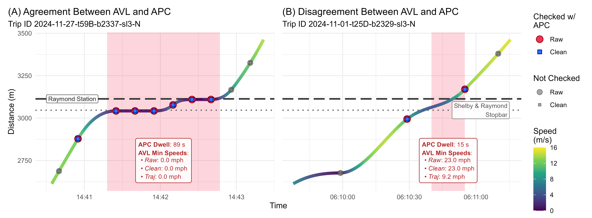
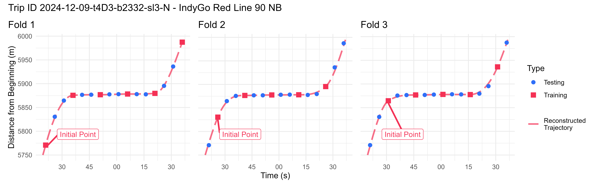
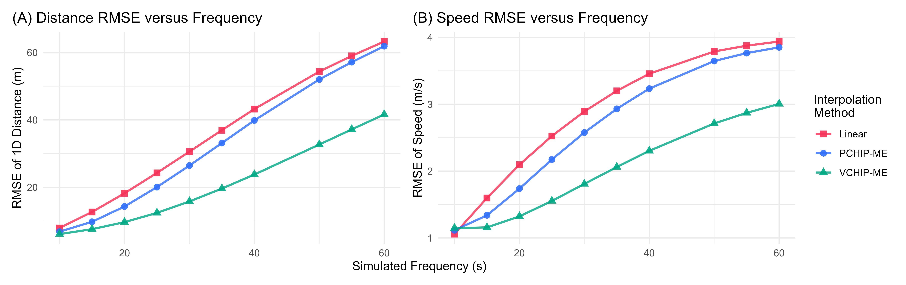
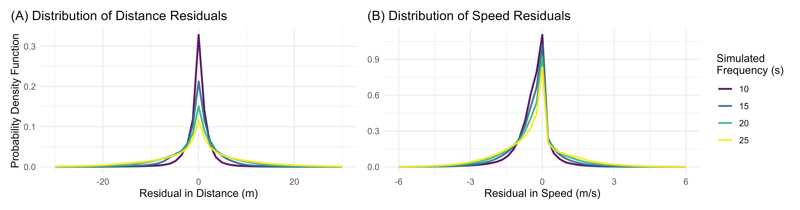
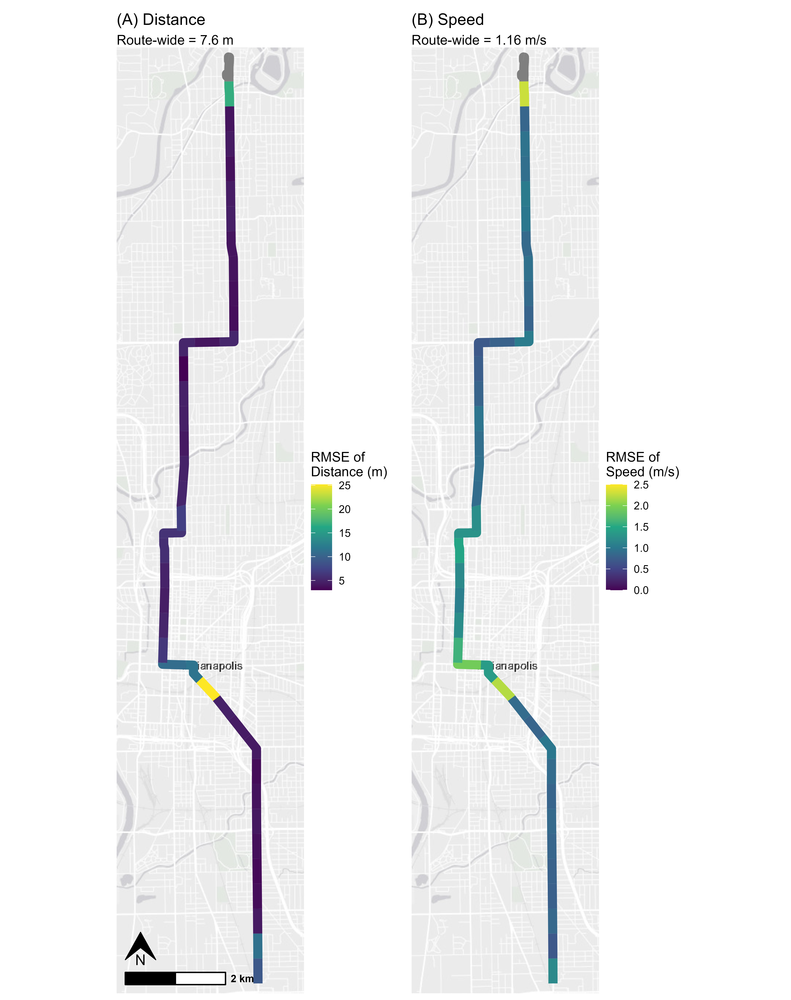

# Introduction

This vignette contains all code used to quantify and visualize the errors in trajectories reconstructed using `transittraj`, as presented and discussed in our Journal of Public Transportation paper. We evaluate data quality in three ways: first, physical realism; second, the AVL's alignment with an independent data source, the bus' APC system; and third, the prediction quality of fit trajectories. While we do not have permission to share the data used in this test, we welcome users to adapt the code the replicate this evaluation using their own data.

This vignette is intended to complement our paper. Check out the full paper for a more thorough discussion of this methodology.

# Data

Let's begin by loading the libraries we'll be using:


``` r
# Data
library(transittraj)
library(tidyverse)

# Spatial
library(sf)
library(stplanr)

# Plotting
library(ggspatial)
library(patchwork)
library(marquee)
library(basemaps)

# Bootstrapping parameters
set.seed(0)
B <- 1:1000
```


``` r
# Plotting parameters
agency_timezone <- "America/New_York"
my_r <- "#f43155"
my_b <- "#2f6ff8"
my_g <- "#00A884"

marquee_label <- function(border = "firebrick",
                          align = "center") {
  
  lab <- classic_style(
    margin = trbl(0),
    padding = trbl(4),
    border = border,
    border_width = trbl(1),
    border_radius = 3,
    align = align
  ) %>%
    modify_style(tag = "ul",
                 padding = trbl(0, 0, 0, em(0.5))) %>%
    modify_style(tag = "li",
                 padding = trbl(0, 0, 0, em(0.5)))
  return(lab)
}
```

We perform this robustness check on AVL data from IndyGo's northbound Red Line BRT service. We accessed IndyGo’s AVL data from their Swiftly endpoint, after which it was reformatted to meet the TIDES standards required by `transittraj` and stored in the dataframe `avl_df`. We do not have permission to share this dataset, and so have pre-loaded it into our RStudio session before running this vignette.


``` r
# Number of observations
paste(dim(avl_df)[1], " observations",
      sep = "")
#> [1] "1707095 observations"

# Number of trips
paste(length(unique(avl_df$trip_id_performed)), " trips",
      sep = "")
#> [1] "3256 trips"

# Time range
paste("Time range: ", as.POSIXct(min(avl_df$event_timestamp), tz = "America/New_York"),
      " - to - ", as.POSIXct(max(avl_df$event_timestamp), tz = "America/New_York"),
      sep = "")
#> [1] "Time range: 2024-11-01 00:00:01 - to - 2024-12-31 23:58:58"
```

The next piece of data required is the northbound Red Line's alignment. This was accessed through IndyGo's GTFS `shapes.txt` file, and is stored in the `sf` object `route_geom`.


``` r
print(route_geom)
#> Simple feature collection with 1 feature and 1 field
#> Geometry type: MULTILINESTRING
#> Dimension:     XY
#> Bounding box:  xmin: 571795.1 ymin: 4395912 xmax: 573767.5 ymax: 4414347
#> Projected CRS: WGS 84 / UTM zone 16N
#> # A tibble: 1 × 2
#>   shape_id                                                                              geometry
#>   <chr>                                                                    <MULTILINESTRING [m]>
#> 1 12057_shp ((573767.5 4395912, 573767 4395940, 573766.6 4395966, 573764.6 4396102, 573764.1 ...
```

With this, we'll go ahead and clean out entire dataset, saving each step to use throughout this vignette:


``` r
# Cleaning parameters
indy_crs <- 32616 # WGS 84 UTM Zone 16N
route_buffer = 50 # meters
min_dist = 200 # meters
min_dur = 90 # seconds
dist_error = 0.001 # meters
max_d_gap = 800 # meters
hampel_t = 3

# Project AVL onto route
distance_df <- get_linear_distances(avl_df = avl_df,
                                    shape_geometry = route_geom,
                                    clip_buffer = route_buffer,
                                    project_crs = indy_crs) %>%
  filter(distance < 20500)

# Step 3
s3 <- clean_overlapping_subtrips(distance_df = distance_df,
                                 check_operator = TRUE,
                                 remove_single_observations = TRUE)
# Step 4
s4 <- clean_jumps(distance_df = s3,
                  t_cutoff = hampel_t)
s4_remov <- clean_jumps(distance_df = s3,
                        return_removals = TRUE,
                        t_cutoff = hampel_t) %>%
  pull(location_ping_id)

# Step 5
s5 <- trim_trips(distance_df = s4)
#> Warning: Trips found with maximum at or before minimum point -- potential wrong direction.
#> Removing the following: 2024-11-22-t325-b2331-sl3-N, 2024-11-25-t803-b2335-sl3-N, 2024-12-05-t60E-b2334-sl3-N, 2024-12-12-t84D-b233C-sl3-N, 2024-12-31-t5-b233D-sl3-N

# Step 6
s6 <- clean_incomplete_trips(distance_df = s5,
                             min_trip_distance = min_dist,
                             min_trip_duration = min_dur,
                             max_distance_gap = max_d_gap)

# Step 7
mono_df <- make_monotonic(distance_df = s6,
                          correct_speed = TRUE,
                          add_distance_error = dist_error,
                          direction = "bidirectional")

# Trajectory
traj <- get_trajectory_fun(distance_df = mono_df)
```

# Physical Realism

## Methods

We evaluate each dataset's -- raw (immediately after projection, `distance_df`) and clean (after monotonic correction, `mono_df`) -- position, speed, and acceleration point values for physical realism. For position, we check that points only move forward; for speed, we check that both AVL-recorded speeds and implied speeds (the slope between each point and the point immediately following it) do not exceed 55 mph; and for acceleration, we check that each point's implied acceleration (the slope in speeds between each point and the point immediately following it) is within $\left[ -0.24, 0.17 \right] \times g$. Below we define those ranges:


``` r
# Global cutoffs
allowable_accel <- c(-0.24, 0.17) * 9.81 # g -> m/s2
allowable_vel <- c(-Inf, 55) / 2.237 # mph -> m/s
stop_cutoff <- 3 / 2.237 # mph -> m/s
```

Next, we define a function to evaluate any arbitrary AVL dataset:


``` r
# Find pointwise violations
points_vio <- function(distance_df) {
  
  # Get point-wise speeds & check for point-wise violations
  check_df <- distance_df %>%
    # select only needed columns
    select(location_ping_id, trip_id_performed, distance,
           speed, event_timestamp) %>%
    arrange(trip_id_performed, event_timestamp) %>%
    group_by(trip_id_performed) %>%
    # calculate dist, time deltas & implied speeds, accels
    mutate(event_timestamp = as.numeric(event_timestamp),
           cummax_dist = cummax(distance),
           delta_dist = lead(distance) - (distance),
           delta_t = lead(event_timestamp) - (event_timestamp),
           delta_speed = lead(speed) - (speed),
           implied_speed = delta_dist / delta_t,
           implied_accel = delta_speed / delta_t) %>%
    ungroup() %>%
    # find violations
    mutate(implied_speed = replace_na(implied_speed, 0), # first/last points
           implied_accel = replace_na(implied_accel, 0), # first/last points
           violate_mono = distance < cummax_dist,
           violate_speed = (speed < allowable_vel[1]) |
             (speed > allowable_vel[2]),
           violate_implied_speed = (implied_speed < allowable_vel[1]) |
             (implied_speed > allowable_vel[2]),
           violate_implied_accel = (implied_accel < allowable_accel[1]) |
             (implied_accel > allowable_accel[2]))
  
  return(check_df)
}

# Aggreagte pointwise violations into trip-wise violations
trips_vio <- function(point_check_df) {
  
  # Get violations by trip
  trips_df <- point_check_df %>%
    select(-c(cummax_dist, delta_dist, delta_t, delta_speed,
              location_ping_id)) %>%
    group_by(trip_id_performed) %>%
    summarize(n_obs = n(),
              violate_mono_count = sum(violate_mono),
              violate_speed_count = sum(violate_speed),
              violate_implied_speed_count = sum(violate_implied_speed),
              violate_implied_accel_count = sum(violate_implied_accel)) %>%
    mutate(violate_mono = violate_mono_count > 0,
           violate_speed = violate_speed_count > 0,
           violate_implied_speed = violate_implied_speed_count > 0,
           violate_implied_accel = violate_implied_accel_count > 0,
           violate_any = violate_mono | violate_speed |
             violate_implied_accel | violate_implied_speed) %>%
    ungroup()
  
  return(trips_df)
}

# Summarize violation rates
phys_eval <- function(distance_df, return_check = FALSE) {
  
  check_df <- points_vio(distance_df = distance_df)
  trips_df <- trips_vio(point_check_df = check_df)
  
  # if want to return point-by-point check
  if (return_check) {
    return(check_df)
  }
  
  # Bootstrap
  points_b <- list()
  trips_b <- list()
  for (i in B) {
    
    # Resample points
    points_resampled <- check_df %>%
      select(location_ping_id,
             violate_mono, violate_speed,
             violate_implied_speed, violate_implied_accel) %>%
      slice_sample(
        # Proportion -- all
        prop = 1,
        # With replacement
        replace = TRUE
      )
    points_est <- points_resampled %>%
      summarize(n_obs = n(),
                n_vio_mono = sum(violate_mono),
                n_vio_speed = sum(violate_speed),
                n_vio_implied_speed = sum(violate_implied_speed),
                n_vio_implied_accel = sum(violate_implied_accel)) %>%
      pivot_longer(cols = c("n_vio_mono",
                            "n_vio_speed", "n_vio_implied_speed",
                            "n_vio_implied_accel"),
                   names_to = "Violation", values_to = "n_obs_vio") %>%
      mutate(perc_obs_vio = n_obs_vio / n_obs)
    
    # Resample trips
    trips_resampled <- trips_df %>%
      select(trip_id_performed,
             violate_mono, violate_speed,
             violate_implied_speed, violate_implied_accel) %>%
      slice_sample(
        # Proportion -- all
        prop = 1,
        # With replacement
        replace = TRUE
      )
    trips_est <- trips_resampled %>%
      summarize(n_trips = n(),
                n_vio_mono = sum(violate_mono),
                n_vio_speed = sum(violate_speed),
                n_vio_implied_speed = sum(violate_implied_speed),
                n_vio_implied_accel = sum(violate_implied_accel)) %>%
      pivot_longer(cols = c("n_vio_mono",
                            "n_vio_speed", "n_vio_implied_speed",
                            "n_vio_implied_accel"),
                   names_to = "Violation", values_to = "n_trips_vio") %>%
      mutate(perc_trips_vio = n_trips_vio / n_trips)
    
    # Save results
    points_b[[i]] <- points_est
    trips_b[[i]] <- trips_est
  }
  points_boot <- bind_rows(points_b, .id = "b_iter")
  trips_boot <- bind_rows(trips_b, .id = "b_iter")
  
  # Bootstrapped standard errors
  points_sd <- points_boot %>%
    group_by(Violation) %>%
    summarize(points_sd = sd(perc_obs_vio)) %>%
    mutate(points_sd = case_when(
      points_sd < 0.00001 ~ "< 0.001%" ,
      .default = scales::percent(points_sd,
                                 accuracy = 0.001)
  ))
  trips_sd <- trips_boot %>%
    group_by(Violation) %>%
    summarize(trips_sd = sd(perc_trips_vio)) %>%
    mutate(trips_sd = case_when(
      trips_sd < 0.00001 ~ "< 0.001%" ,
      .default = scales::percent(trips_sd,
                                 accuracy = 0.001)
  ))
  
  # Summarize point-wise violations
  point_summ <- check_df %>%
    select(-c(cummax_dist, delta_dist, delta_t, delta_speed,
              location_ping_id)) %>%
    summarize(n_obs = n(),
              n_vio_mono = sum(violate_mono),
              n_vio_speed = sum(violate_speed),
              n_vio_implied_speed = sum(violate_implied_speed),
              n_vio_implied_accel = sum(violate_implied_accel)) %>%
    pivot_longer(cols = c("n_vio_mono",
                          "n_vio_speed", "n_vio_implied_speed",
                          "n_vio_implied_accel"),
                 names_to = "Violation", values_to = "n_obs_vio") %>%
    left_join(y = points_sd,
              by = "Violation") %>%
    mutate(perc_obs_vio = n_obs_vio / n_obs,
           perc_obs_vio = scales::percent(perc_obs_vio,
                                          accuracy = 0.01),
           Violation = case_when(
             Violation == "n_vio_mono" ~ "Weak Monotonicity",
             Violation == "n_vio_speed" ~ "Recorded Speed",
             Violation == "n_vio_implied_speed" ~ "Implied Speed",
             Violation == "n_vio_implied_accel" ~ "Implied Acceleration",
           ),
           n_obs = format(n_obs, big.mark = ",", scientific = FALSE),
           n_obs_vio = format(n_obs_vio, big.mark = ",", scientific = FALSE))
  
  # Summarize trip-wise violations
  trip_summ <- trips_df %>%
    summarize(n_trips = n(),
              n_vio_mono = sum(violate_mono),
              n_vio_speed = sum(violate_speed),
              n_vio_implied_speed = sum(violate_implied_speed),
              n_vio_implied_accel = sum(violate_implied_accel)) %>%
    pivot_longer(cols = c("n_vio_mono",
                          "n_vio_speed", "n_vio_implied_speed",
                          "n_vio_implied_accel"),
                 names_to = "Violation", values_to = "n_trips_vio") %>%
    left_join(y = trips_sd,
              by = "Violation") %>%
    mutate(perc_trips_vio = n_trips_vio / n_trips,
           perc_trips_vio = scales::percent(perc_trips_vio,
                                            accuracy = 0.01),
           Violation = case_when(
             Violation == "n_vio_mono" ~ "Weak Monotonicity",
             Violation == "n_vio_speed" ~ "Recorded Speed",
             Violation == "n_vio_implied_speed" ~ "Implied Speed",
             Violation == "n_vio_implied_accel" ~ "Implied Acceleration"
           ),
           n_trips = format(n_trips, big.mark = ",", scientific = FALSE),
           n_trips_vio = format(n_trips_vio, big.mark = ",",
                                scientific = FALSE))
  
  # join trips & points, return
  summ <- left_join(x = trip_summ, y = point_summ,
                    by = "Violation")
  return(summ)
}
```

## Results

Finally, we run this check on our raw and clean datasets:


``` r
# Get raw & cleaned evaluations
phys_eval_df <- bind_rows(
  phys_eval(distance_df) %>%
    mutate(Dataset = "Raw"),
  phys_eval(mono_df) %>%
    mutate(Dataset = "Clean")
)

# number of observations & trips
knitr::kable(phys_eval_df %>% distinct(Dataset, n_trips, n_obs))
```


|Dataset |n_trips |n_obs     |
|:-------|:-------|:---------|
|Raw     |3,253   |1,348,251 |
|Clean   |3,100   |1,304,499 |


``` r

# Make table pretty
phys_eval_clean <- phys_eval_df %>%
  mutate(trips_vio = paste(n_trips_vio, ", ", perc_trips_vio,
                           " (", trips_sd, ")", 
                           sep = ""),
         obs_vio = paste(n_obs_vio, ", ", perc_obs_vio,
                         " (", points_sd, ")",
                         sep = "")) %>%
  select(Violation, Dataset, trips_vio, obs_vio)
phys_eval_piv <- phys_eval_clean %>%
  pivot_wider(id_cols = "Violation", names_from = "Dataset",
              values_from = c("trips_vio", "obs_vio"),
              names_glue = "{Dataset}_{.value}")

# Print table
knitr::kable(phys_eval_piv)
```


|Violation            |Raw_trips_vio          |Clean_trips_vio        |Raw_obs_vio              |Clean_obs_vio         |
|:--------------------|:----------------------|:----------------------|:------------------------|:---------------------|
|Weak Monotonicity    |2,970, 91.30% (0.494%) |0, 0.00% (< 0.001%)    |201,124, 14.92% (0.031%) |0, 0.00% (< 0.001%)   |
|Recorded Speed       |7, 0.22% (0.084%)      |6, 0.19% (0.079%)      |8, 0.00% (< 0.001%)      |7, 0.00% (< 0.001%)   |
|Implied Speed        |103, 3.17% (0.301%)    |84, 2.71% (0.289%)     |106, 0.01% (< 0.001%)    |86, 0.01% (< 0.001%)  |
|Implied Acceleration |607, 18.66% (0.697%)   |1,349, 43.52% (0.901%) |1,214, 0.09% (0.003%)    |2,697, 0.21% (0.004%) |


# Data Source Alignment

## Methods

We have a dataset of automatic passenger counter (APC) data, `apc_df`, loaded into our `RStudio` environment. Each row represents a bus serving one stop, and includes information about the trip, the stop name, the arrival (`t_in`) and departure (`t_out`) times, and the dwell time:


``` r
head(apc_df)
#>   service_date           trip_id_performed                           stop_name                t_in               t_out dwell trip_in_traj
#> 1   2024-11-01 2024-11-01-t1FB-b232E-sl3-N                               CTC-G 2024-11-01 05:20:12 2024-11-01 05:20:12     0         TRUE
#> 2   2024-11-01 2024-11-01-t1FB-b232E-sl3-N               Statehouse Station NB 2024-11-01 05:21:36 2024-11-01 05:21:36     0         TRUE
#> 3   2024-11-01 2024-11-01-t1FB-b232E-sl3-N Capitol Ave & Vermont St Station NB 2024-11-01 05:22:42 2024-11-01 05:22:53    11         TRUE
#> 4   2024-11-01 2024-11-01-t1FB-b232E-sl3-N     Capitol Ave & 9th St Station NB 2024-11-01 05:24:56 2024-11-01 05:24:56     0         TRUE
#> 5   2024-11-01 2024-11-01-t1FB-b232E-sl3-N    Capitol Ave & 14th St Station NB 2024-11-01 05:26:01 2024-11-01 05:26:01     0         TRUE
#> 6   2024-11-01 2024-11-01-t1FB-b232E-sl3-N                IU Health Station NB 2024-11-01 05:26:47 2024-11-01 05:26:47     0         TRUE
```


``` r
# Total number of observations
dim(apc_df)[1]
#> [1] 77331

# Total number of trips
length(unique(apc_df$trip_id_performed))
#> [1] 3132

# Number of APC trips which are in AVL
sum(apc_df %>%
      distinct(trip_id_performed, trip_in_traj) %>%
      pull(trip_in_traj))
#> [1] 2823
```

Unlike most APC systems, IndyGo's vendor does not record door events as entrance and exit times; rather, this system records the arrival and departure times as, roughly, the moments the bus begins its first stationary period and ends its final stationary period near each stop. Thus, we would not expect the bus to stand still during each entire "dwell," though we would expect the trajectory to stop *at some point* during each dwell. The function below matches an arbritary AVL dataset (either cleaned, raw, or interpolated from a trajectory) to this APC dataset and checks whether this condition holds:


``` r
# Matches AVL and APC datasets
avl_apc_match <- function(distance_df, apc_df) {
  
  avl_df2 <- distance_df %>%
    arrange(trip_id_performed, event_timestamp) %>%
    group_by(trip_id_performed) %>%
    mutate(stop_name = NA, inout = NA,
           type = "AVL",
           avl_min_t = min(event_timestamp),
           avl_max_t = max(event_timestamp)) %>%
    ungroup() %>%
    select(trip_id_performed, event_timestamp, speed,
           stop_name, inout, avl_min_t, avl_max_t, type,
           location_ping_id)
  
  apc_stops_df <- apc_df %>%
    filter(dwell > 0) %>%
    select(trip_id_performed, t_in, t_out, stop_name) %>%
    pivot_longer(cols = c("t_in", "t_out"),
                 names_to = "inout", values_to = "event_timestamp") %>%
    mutate(speed = NA,
           type = "APC")

  # bind together APC & AVL to find points
  # can't join bc we also want to include one extra point
  avl_apc <- bind_rows(avl_df2, apc_stops_df) %>%
    # Keep only trips in both datasets
    filter((trip_id_performed %in% apc_stops_df$trip_id_performed) &
             (trip_id_performed %in% avl_df2$trip_id_performed)) %>%
    # Remove APC rows occuring before or after a trip's AVL
    arrange(trip_id_performed, event_timestamp) %>%
    fill(avl_min_t, .direction = "updown", .by = trip_id_performed) %>%
    fill(avl_max_t, .direction = "downup", .by = trip_id_performed) %>%
    filter((event_timestamp >= avl_min_t) & (event_timestamp <= avl_max_t)) %>%
    select(-c(avl_min_t, avl_max_t)) %>%
    group_by(trip_id_performed) %>%
    # fill in stop IDs between AVL timepoints
    mutate(f_d = stop_name,
           f_u = stop_name) %>%
    fill(f_d, .direction = "down") %>%
    fill(f_u, .direction = "up") %>%
    ungroup() %>%
    mutate(stop_name = if_else(f_d == f_u,
                               f_d,
                               false = NA)) %>%
    select(-c(f_d, f_u)) %>%
    # pull stop ID up one more
    group_by(trip_id_performed) %>%
    mutate(stop_name = case_when(
      # if NA and next isn't NA, set to next
      is.na(stop_name) & !is.na(lead(stop_name)) ~ lead(stop_name),
      # if isn't NA, leave as is
      !is.na(stop_name) ~ stop_name,
      # otherwise, leave as NA
      .default = NA
    )) %>%
    ungroup() %>%
    # Remove timepoints not assigned to an APC period
    filter(!is.na(stop_name) & type == "AVL") %>%
    select(-c(type, inout))
  
  return(avl_apc)
}

# Sumamrizes
avl_apc_eval <- function(avl_apc) {
  
  avl_stops <- avl_apc %>%
    group_by(trip_id_performed, stop_name) %>%
    summarize(min_speed = min(speed),
              .groups = "keep") %>%
    mutate(makes_stop = min_speed < stop_cutoff) %>%
    ungroup()
  trip_stops <- avl_stops %>%
    group_by(trip_id_performed) %>%
    summarize(n_apc_stops = n(),
              n_avl_stops = sum(makes_stop)) %>%
    mutate(vio = n_avl_stops < n_apc_stops) %>%
    ungroup()
  
  # Bootstrap
  points_b <- list()
  trips_b <- list()
  for (i in B) {
    
    # Resample points
    points_resampled <- avl_stops %>%
      select(stop_name, makes_stop) %>%
      slice_sample(
        # Proportion -- all
        prop = 1,
        # With replacement
        replace = TRUE
      )
    points_est <- points_resampled %>%
      summarize(n_apc_stops = n(),
                n_avl_stops = sum(makes_stop),
              ) %>%
      pivot_longer(cols = c("n_avl_stops"),
                   names_to = "Violation", values_to = "n_obs_matching") %>%
      mutate(n_obs_vio = n_apc_stops - n_obs_matching,
             perc_obs_vio = (n_obs_vio / n_apc_stops))
    
    # Resample trips
    trips_resampled <- trip_stops %>%
      select(trip_id_performed, vio) %>%
      slice_sample(
        # Proportion -- all
        prop = 1,
        # With replacement
        replace = TRUE
      )
    trips_est <- trips_resampled %>%
      summarize(n_trips = n(),
                n_vio = sum(vio)) %>%
      pivot_longer(cols = c("n_vio"),
                   names_to = "Violation", values_to = "n_trips_vio") %>%
      mutate(perc_trips_vio = n_trips_vio / n_trips)
    
    # Save results
    points_b[[i]] <- points_est
    trips_b[[i]] <- trips_est
  }
  points_boot <- bind_rows(points_b, .id = "b_iter")
  trips_boot <- bind_rows(trips_b, .id = "b_iter")
  
  # Get standard errors
  points_sd <- points_boot %>%
    group_by(Violation) %>%
    summarize(points_sd = sd(perc_obs_vio)) %>%
    mutate(points_sd = case_when(
      points_sd < 0.00001 ~ "< 0.001%" ,
      .default = scales::percent(points_sd,
                                 accuracy = 0.001)
  ))
  trips_sd <- trips_boot %>%
    group_by(Violation) %>%
    summarize(trips_sd = sd(perc_trips_vio)) %>%
    mutate(trips_sd = case_when(
      trips_sd < 0.00001 ~ "< 0.001%" ,
      .default = scales::percent(trips_sd,
                                 accuracy = 0.001)
  ))
  
  # summary
  point_summ <- avl_stops %>%
    summarize(n_apc_stops = n(),
              n_avl_stops = sum(makes_stop),
              ) %>%
    pivot_longer(cols = c("n_avl_stops"),
                 names_to = "Violation", values_to = "n_obs_matching") %>%
    left_join(y = points_sd,
              by = "Violation") %>%
    mutate(n_obs_vio = n_apc_stops - n_obs_matching,
           perc_obs_vio = (n_obs_vio / n_apc_stops),
           perc_obs_vio = scales::percent(perc_obs_vio,
                                          accuracy = 0.01),
           Violation = "APC Dwell",
           n_apc_stops = format(n_apc_stops, big.mark = ",", scientific = FALSE),
           n_obs_vio = format(n_obs_vio, big.mark = ",", scientific = FALSE)) %>%
    select(-c(n_obs_matching)) %>%
    rename(n_obs = n_apc_stops)
  
  trip_summ <- trip_stops %>%
    summarize(n_trips = n(),
              n_vio = sum(vio)) %>%
    pivot_longer(cols = c("n_vio"),
                 names_to = "Violation", values_to = "n_trips_vio") %>%
    left_join(y = trips_sd,
              by = "Violation") %>%
    mutate(perc_trips_vio = n_trips_vio / n_trips,
           perc_trips_vio = scales::percent(perc_trips_vio,
                                            accuracy = 0.01),
           Violation = "APC Dwell",
           n_trips = format(n_trips, big.mark = ",", scientific = FALSE),
           n_trips_vio = format(n_trips_vio, big.mark = ",", scientific = FALSE))
  
  # join trip, point summary & return
  summ <- left_join(x = trip_summ, y = point_summ,
                    by = "Violation")
  return(summ)
}
```

We'll match our raw & cleaned AVL to the APC datasets:


``` r
# Get matched datasets
raw_avl_apc <- avl_apc_match(distance_df = distance_df,
                             apc_df = apc_df)
mono_avl_apc <- avl_apc_match(distance_df = mono_df,
                              apc_df = apc_df)
```

Next, we create a "pseudo-AVL" dataset using our fit trajectories. Over each APC dwell period, we interpolate new distance and speed points at a resolution of 0.1 seconds.


``` r
keep_trip_stops <- mono_avl_apc %>%
    distinct(trip_id_performed, stop_name) %>%
    mutate(trip_stop = paste(trip_id_performed, stop_name, sep = "-")) %>%
    pull(trip_stop)
# "uncount" APC dataframe by timestep
tstep <- 0.1
apc_uncount <- apc_df %>%
  filter(dwell > 0) %>%
  mutate(t_in = as.numeric(t_in),
         t_out = as.numeric(t_out)) %>%
  select(trip_id_performed, stop_name, t_in, t_out) %>%
  # filter down to trip-stops in mono DF -- roughly 3 removed
  mutate(trip_stop = paste(trip_id_performed, stop_name, sep = "-")) %>%
    filter(trip_stop %in% keep_trip_stops) %>%
  uncount(weights = pmax(1, floor((t_out - t_in) / tstep + 1))) %>%
  group_by(trip_id_performed, stop_name) %>%
  mutate(event_timestamp = seq(from = t_in[1],
                               to = t_out[1],
                               by = tstep)) %>%
  ungroup() %>%
  select(-c(t_in, t_out, trip_stop))

# interpolate for speed values at these timepoints
traj_apc <- predict(object = traj,
                    new_times = apc_uncount,
                    deriv = 1) %>%
  rename(speed = interp) %>%
  select(-deriv)
```

Before displaying the results, we'll plot some example trips. Below we focus on two trips at Raymond Station, a far-side stop at the intersection of Sehelby & Raymond. We define a function to plot the AVL and APC data for any arbitrary trip ID:


``` r
# General feature info
plot_stop <- "Raymond Station NB"
d_expand <- c(-500, 350)
stop_df <- stops %>%
    filter(stop_name == plot_stop)
plot_d <- rep(stop_df$distance, 2) + d_expand
signals_df <- signals %>%
  filter(distance >= plot_d[1] &
           distance <= plot_d [2])

# General function for arbitrary trip
p_trip <- function(plot_trip) {
  # APC data
  stop_times <- apc_df %>%
    filter((trip_id_performed == plot_trip) &
             (stop_name == plot_stop)) %>%
    select(t_in, t_out) %>%
    mutate(t_in = as.POSIXct(t_in, tz = agency_timezone),
           t_out = as.POSIXct(t_out, tz = agency_timezone))
  
  # AVL point data
  point_df <- rbind(
    distance_df %>%
        filter(trip_id_performed == plot_trip) %>%
        filter(distance >= plot_d[1] &
                 distance <= plot_d[2]) %>%
        select(event_timestamp, distance, location_ping_id, speed) %>%
        mutate(Type = "Raw"),
    mono_df %>%
      filter(trip_id_performed == plot_trip) %>%
      filter(distance >= plot_d[1] &
               distance <= plot_d[2]) %>%
      select(event_timestamp, distance, location_ping_id, speed) %>%
      mutate(Type = "Clean")
  ) %>%
    mutate(consider_APC = (location_ping_id %in% raw_avl_apc$location_ping_id),
           Type = factor(Type, levels = c("Raw", "Clean")))
  consider_df <- point_df %>%
    filter(consider_APC)
  ref_df <- point_df %>%
    filter(!consider_APC)
  
  # Traj data
  trip_df <- predict(object = traj,
                     trips = plot_trip,
                     distance_lims = plot_d,
                     timestep = 0.1,
                     deriv = c(0, 1)) %>%
    pivot_wider(id_cols = c("trip_id_performed", "event_timestamp"),
                names_from = "deriv", values_from = "interp") %>%
    rename(distance = `0`,
           speed = `1`) %>%
    mutate(event_timestamp = as.POSIXct(event_timestamp, tz = agency_timezone))
  
  # Label
  lab_df <- stop_times %>%
    mutate(x = (as.numeric(t_in) + as.numeric(t_out)) / 2,
           x = as.POSIXct(x, tz = agency_timezone),
           y = 2750,
           t = as.numeric(t_out) - as.numeric(t_in)) %>%
    mutate(min_raw = consider_df %>%
             filter(Type == "Raw") %>%
             pull(speed) %>%
             min() * 2.237,
           min_clean = consider_df %>%
             filter(Type == "Raw") %>%
             pull(speed) %>%
             min() * 2.237,
           min_traj = trip_df %>%
             filter(event_timestamp >= t_in &
                      event_timestamp <= t_out) %>%
             pull(speed) %>%
             min() * 2.237,
           min_raw = sprintf(min_raw, fmt = "%.1f"),
           min_clean = sprintf(min_clean, fmt = "%.1f"),
           min_traj = sprintf(min_traj, fmt = "%.1f"),
           lab = paste("**APC Dwell**: ", t, " s",
                       "  \n**AVL Min Speeds**:",
                       "  \n  - *Raw*: ", min_raw, " mph",
                       "  \n  - *Clean*: ", min_clean, " mph",
                       "  \n  - *Traj*: ", min_traj, " mph",
                       sep = ""))
  
  # Create plot
  p <- ggplot() +
    geom_rect(data = stop_times,
              aes(xmin = t_in, xmax = t_out, ymin = -Inf, ymax = Inf),
              fill = my_r, alpha = 0.2, color = NULL) +
    geom_hline(data = signals_df,
               aes(yintercept = distance, linetype = "Signal"),
               color = "grey40", linewidth = 0.8) +
    geom_hline(data = stop_df,
               aes(yintercept = distance, linetype = "BRT Stop"),
               color = "grey20", linewidth = 1) +
    scale_linetype_manual(name = "Features",
                          values = c("Signal" = "dotted",
                                     "BRT Stop" = "longdash"),
                          guide = FALSE) +
    geom_line(data = trip_df,
              aes(x = event_timestamp, y = distance, color = speed),
              linetype = "solid", linewidth = 2) +
    scale_color_viridis_c(name = "Speed\n(m/s)",
                          limits = c(0, 16)) +
    ggnewscale::new_scale_color() +
    geom_point(data = consider_df,
               aes(x = event_timestamp, y = distance,
                   color = Type, size = Type, shape = Type, fill = Type),
               stroke = 0.6) +
    scale_fill_manual(name = "Checked w/\nAPC",
                      values = c("Raw" = my_r,
                                 "Clean" = my_b),
                      guide = guide_legend(order = 1)) +
    scale_color_manual(name = "Checked w/\nAPC",
                       values = c("Raw" = "darkred",
                                  "Clean" = "navy"),
                      guide = guide_legend(order = 1)) +
    scale_shape_manual(name = "Checked w/\nAPC",
                       values = c("Raw" = 21,
                                  "Clean" = 22),
                      guide = guide_legend(order = 1)) +
    scale_size_manual(name = "Checked w/\nAPC",
                      values = c("Raw" = 4,
                                 "Clean" = 2.5),
                      guide = guide_legend(order = 1)) +
    ggnewscale::new_scale("shape") +
    ggnewscale::new_scale("size") +
    geom_point(data = ref_df,
               aes(x = event_timestamp, y = distance,
                   size = Type, shape = Type),
               stroke = 0.4, color = "grey15", fill = "grey50",
               alpha = 0.7) +
    scale_shape_manual(name = "Not Checked",
                       values = c("Raw" = 21,
                                  "Clean" = 22),
                      guide = guide_legend(order = 2)) +
    scale_size_manual(name = "Not Checked",
                      values = c("Raw" = 3.2,
                                 "Clean" = 1.7),
                      guide = guide_legend(order = 2)) +
    geom_marquee(data = lab_df,
                 aes(x = x, y = y, label = lab),
                 hjust = 0.5, size = 3, color = "firebrick", fill = "#FFFFFFE6",
                 style = marquee_label(align = "left")) +
    theme_minimal() +
    labs(x = "Time",
         y = "Distance (m)") +
    theme(plot.title.position = "plot")

  return(p)
}

```

Below we plot one trip in which the two data sources align, and one trip in which they do not:


``` r
# (A) OK Trip
p_ok <- p_trip("2024-11-27-t59B-b2337-sl3-N") +
  geom_label(data = stop_df,
             aes(x = as.POSIXct("2024-11-27 14:40:30", tz = agency_timezone),
                 y = distance, label = "Raymond Station"),
             color = "grey15", fill = "white", alpha = 0.9,
             size = 3, hjust = 0) +
  labs(title = "(A) Agreement Between AVL and APC",
       subtitle = "Trip ID 2024-11-27-t59B-b2337-sl3-N")

# (B) Miss Trip
p_miss <- p_trip("2024-11-01-t25D-b2329-sl3-N") +
  geom_label(data = signals_df,
             aes(x = as.POSIXct("2024-11-01 06:11:15", tz = agency_timezone),
                 y = distance, label = "Shelby & Raymond\nStopbar"),
             color = "grey30", fill = "white", alpha = 0.9,
             size = 3, hjust = 1) +
  labs(title = "(B) Disagreement Between AVL and APC",
       subtitle = "Trip ID 2024-11-01-t25D-b2329-sl3-N")

# Combine
p_apc <- p_ok + p_miss +
  plot_layout(ncol = 2, nrow = 1, axis_titles = "collect",
              axes = "collect", guides = "collect")
p_apc
```




## Results

With this, we run the above function to evaluate the data quality across the raw AVL, the fully-cleaned monotonic AVL, and the fit trajectory:


``` r
# Get raw & cleaned evaluations
data_eval_df <- bind_rows(
  avl_apc_eval(avl_apc = raw_avl_apc) %>%
    mutate(Dataset = "Raw"),
  avl_apc_eval(avl_apc = mono_avl_apc) %>%
    mutate(Dataset = "Clean"),
  avl_apc_eval(avl_apc = traj_apc) %>%
    mutate(Dataset = "Trajectory")
) 

# number of observations & trips
knitr::kable(data_eval_df %>% distinct(Dataset, n_trips, n_obs))
```


|Dataset    |n_trips |n_obs  |
|:----------|:-------|:------|
|Raw        |2,941   |52,203 |
|Clean      |2,821   |50,354 |
|Trajectory |2,821   |50,354 |


``` r

# Make final table pretty
data_eval_clean <- data_eval_df %>%
  mutate(Dataset = factor(Dataset,
                          levels = c("Raw", "Clean", "Trajectory")),
         trips_vio = paste(n_trips_vio, ", ", perc_trips_vio, 
                           " (", trips_sd, ")",
                           sep = ""),
         obs_vio = paste(n_obs_vio, " (", perc_obs_vio, 
                         " (", points_sd, ")",
                         sep = "")) %>%
  select(Violation, Dataset, trips_vio, obs_vio) %>%
  rename(`Trips with Violation` = trips_vio,
         `Observations Violating` = obs_vio) %>%
  arrange(Dataset)
knitr::kable(data_eval_clean)
```


|Violation |Dataset    |Trips with Violation   |Observations Violating |
|:---------|:----------|:----------------------|:----------------------|
|APC Dwell |Raw        |1,035, 35.19% (0.888%) |1,729 (3.31% (0.081%)  |
|APC Dwell |Clean      |592, 20.99% (0.818%)   |796 (1.58% (0.055%)    |
|APC Dwell |Trajectory |453, 16.06% (0.699%)   |574 (1.14% (0.047%)    |


# Prediction

In this section, we estimate the prediction error of fit trajectories. Our goals here are threefold: first, to give users a rough sense of the magnitude of error in reconstructed position and speed estimates; second, to evaluate the robustness of trajectories to low polling frequencies; and third, to evaluate how the different interpolation methods supported by `transittraj` compare.

## Methods

### Cross-Validation Approach

Using a dataset with 5-second AVL pings, we evaluate the proposed workflow on simulated polling frequencies $f_\text{sim}$ from 5 to 60 seconds, in 5-second intervals. For each simulated frequency, we select a training dataset by keeping every $f_\text{sim} / 5$ points. All remaining points are used as the testing dataset. This is repeated $f_\text{sim} / 5$ times, shifting the training dataset by one point each time. An example for $f_\text{sim} = 15$ seconds, with $15 / 5 = 3$ folds, is shown in the figure below.



For each CV fold, we apply the same cleaning methodology discussed in the the AVL cleaning vignette. To understand the relative performance of the different trajectory reconstruction methods, we then apply three separate interpolation methods: first, the recommended VCHIP-ME cubic splines; second, PCHIP-ME, cubic splines with monotonic enforcement but without observed bus speeds; and third, simple linear interpolation without monotonic enforcement and without knowledge of observed bus speeds.

Once each trajectory was fit to the training dataset, we calculate two error terms relative to the raw testing dataset: first, the one-dimensional distance along the route between each test point and the fit trajectory; and second, the difference in speed between each test point and the trajectory. We then calculate the root mean square error (RMSE) of each of each error type across all folds of each trajectory type and simulated frequency. Finally, to identify spatial patterns in error, we group point errors into 500-meter segments along the route, and calculate the RMSE within each zone.

### Initial Cleaning & Filtering

Throughout this robustness check, we aim to exclude points which are off-route, in an overlapped sub-trip, or a trip tail. We also only wish to keep trips with sufficient data and with a 5-second polling frequency. We will keep pings not off-route, not in a trip tail, and not in an overlapped subtrip. We will retain outliers, as these will be identified in each fold of the cross-validation process.


``` r
keep_pings <- c(s6$location_ping_id,
                s4_remov)
```

Next, we'll find the trips we want to keep. After filtering the dataset to the pings we're keeping, we'll retain trips with at least one remaining observations and a polling frequency below 7 seconds (corresponding to an average polling frequency of 5 seconds, with random gaps).


``` r
avl_summ <- avl_df %>%
  filter(location_ping_id %in% keep_pings) %>%
  group_by(trip_id_performed) %>%
  summarize(t_min = min(event_timestamp),
            t_max = max(event_timestamp),
            t = as.numeric(difftime(t_max, t_min, units = "s")),
            n_obs = n(),
            freq = t / n_obs)
keep_trips <- avl_summ %>%
  filter((n_obs > 1) & (freq < 7)) %>%
  pull(trip_id_performed)

paste(length(keep_trips), " trips",
      sep = "")
#> [1] "1162 trips"
```

In total, the CV robustness check will evaluate 1,162 trips. Using the trips and points we wish to retain, we'll finalize our cleaned, initial dataset.


``` r
base_df <- s3 %>%
  filter((trip_id_performed %in% keep_trips) &
           (location_ping_id %in% keep_pings)) %>%
  select(event_timestamp, trip_id_performed, distance, speed, location_ping_id)

# Summarize trip-wise polling intervals
base_summ <- base_df %>%
  group_by(trip_id_performed) %>%
  summarize(t_min = min(event_timestamp),
            t_max = max(event_timestamp),
            t = as.numeric(difftime(t_max, t_min, units = "s")),
            n_obs = n(),
            freq = t / n_obs) %>%
  ungroup() %>%
  summarize(sum_t = sum(t),
            sum_n = sum(n_obs),
            freq_25th = quantile(freq, 0.25),
            freq_75th = quantile(freq, 0.75)) %>%
  mutate(mean_freq = sum_t / sum_n)
cat("Avg polling frequency: ", base_summ$mean_freq,
    "\nIQR: ", base_summ$freq_25th, " - ", base_summ$freq_75th,
    sep = "")
#> Avg polling frequency: 5.840361
#> IQR: 5.376368 - 6.333333
```

### Implementation

With our base dataset, we can perform the cross-validation. We'll define three primary functions to perform the process:

  * A fold function `cv_fold()`, to create a testing and training dataset;
  
  * A cleaning function `clean_avl()`, to implement the data cleaning workflow on the training dataset;
  
  * And an error calculation function `traj_err()`, to calculate the two residual terms (1D distance and speed) between the testing dataset and fit trajectories.
  
Below we begin by defining the folding function. Given the raw dataset's 5-second frequency, this takes in a simulated frequency (`test_freq`) and iteration number (`offset`), returning a list containing the testing and training dataset at that frequency and offset.


``` r
base_freq <- 5 # avg ping frequency

cv_fold <- function(test_freq, offset) {
  keep_mod <- test_freq / base_freq

  train_df <- base_df %>%
    group_by(trip_id_performed) %>%
    mutate(row = row_number() + offset) %>%
    filter((row %% keep_mod) == 0) %>%
    ungroup()
  test_df <- base_df %>%
    filter(!(location_ping_id %in% train_df$location_ping_id))

  return(list(train_df,
              test_df))
}
```

Next we define our cleaning process. This implements the workflow through step 6 (removing insufficient trips) on the training data. Step 7 (monotonic enforcement) will be performed in the loop later.


``` r
clean_avl <- function(train_df) {

  # Step 4
  s4 <- clean_jumps(distance_df = train_df)

  # Step 5
  s5 <- trim_trips(distance_df = s4)

  # Step 6
  s6 <- clean_incomplete_trips(distance_df = s5,
                               min_trip_distance = 500,
                               min_trip_duration = 90,
                               max_distance_gap = 800)

  return(s6)
}
```

Finally, we'll define a function to calculate our residuals. This one is a bit more complicated. We begin by using the the `predict()` method on the input trajectory to find the trajectory's value at the testing dataset's timestamps. For differentiable trajectories (in which `deriv = c(0, 1)`), the speed calculation is simple; for the linear trajectory, we use the cleaned training dataset (`fit_df`) to estimate the speed by finding the slope between the nearest leading and lagging training points on either side of each testing point. Once this is complete, 1D and speed residuals are the simple difference between the calculated and observed values.


``` r
# Find current trajectory's deviation from base data
traj_err <- function(traj, test_df, test_freq, offset, deriv, fit_df = NULL) {

  # Get calculated traj
  # also filters test data to only those between observed train data points
  calc_df <- predict(object = traj,
                     new_times = (test_df %>%
                       select(event_timestamp, trip_id_performed, location_ping_id)),
                     deriv = deriv)

  if (1 %in% deriv) {
    pivot_df <- calc_df %>%
      pivot_wider(id_cols = c("location_ping_id"),
                  names_from = "deriv", names_glue = "interp_{.name}",
                  values_from = "interp") %>%
      rename(traj_dist = interp_0,
             traj_speed = interp_1)
  } else {
    # if linear interpolation, calculate speeds using surrounding fit points
    speed_calc <- bind_rows(
      # get cleaned training data
      fit_df %>%
        select(-row) %>%
        mutate(event_timestamp = as.numeric(event_timestamp)) %>%
        arrange(trip_id_performed, event_timestamp) %>%
        group_by(trip_id_performed) %>%
        # calculate linear slope between all training points
        mutate(lin_speed_forward = (lead(distance) - distance) /
                 (lead(event_timestamp) - event_timestamp),
               type = "train") %>%
        ungroup(),
      # get testing points
      calc_df %>%
        rename(distance = interp) %>%
        mutate(speed = NA,
               lin_speed_forward = NA,
               type = "test") %>%
        select(-deriv)
    ) %>%
      arrange(trip_id_performed, event_timestamp) %>%
      group_by(trip_id_performed) %>%
      # carry forward slope from training points to next testing points
      mutate(lin_speed_forward = zoo::na.locf(lin_speed_forward)) %>%
      ungroup() %>%
      filter(type == "test") %>%
      mutate(traj_speed = lin_speed_forward) %>%
      select(location_ping_id, traj_speed)

    pivot_df <- calc_df %>%
      pivot_wider(id_cols = c("location_ping_id"),
                  names_from = "deriv", names_glue = "interp_{.name}",
                  values_from = "interp") %>%
      left_join(y = speed_calc, by = "location_ping_id") %>%
      rename(traj_dist = interp_0)
  }

  # Keep only pings in range of reconstructed traj
  obs_df <- base_df %>%
    filter(location_ping_id %in% pivot_df$location_ping_id)

  # Final linear (1D) residuals
  res_1D_df <- obs_df %>%
    left_join(pivot_df, by = "location_ping_id") %>%
    mutate(res_dist_1D = distance - traj_dist,
           res_speed = speed - traj_speed) %>%
    filter(!(is.na(res_dist_1D)) &
             !(is.na(res_speed))) %>%
    mutate(freq = test_freq,
           off = offset)

  return(res_1D_df)
}
```

Those three functions are the bulk of the work we need. We'll set up a nested for loop to cycle through each simulated frequency, then within each offset in that frequency. Within each offset, we use `cv_fold()` to retrieve the testing and training datasets, then `clean_avl()` to retrieve the cleaned dataset through step 7. We'll use the base workflow function `make_monotonic()` to make the dataset monotonic, then fit the three trajectories. Finally, we use `traj_err()` to find the residuals along each trajectory and store the results in a list.


``` r
#' we'll split this into two batches & run the vignette separately,
#' because it takes very long (a lot of iterations of the entire workflow)
#'    - first batch: c(10, 15, 20, 25, 30). for main results table.
#'    - second batch: c(35, 40, 50, 55, 60). to include in scaling figure.
#'    - third batch: c(45). missed it in the second batch. oops.
test_freqs <- c(10, 15, 20, 25, 30)
res_list <- list()
train_list <- list()

for (freq in test_freqs) {
  print(paste("Current freq: ", freq, " s",
              sep = ""))

  offsets <- 0:((freq / base_freq) - 1)

  for (off in offsets) {
    print(paste("Current offset: ", off + 1, " of ", max(offsets) + 1,
                sep = ""))

    # Pull data
    current_fold <- cv_fold(test_freq = freq,
                              offset = off)
    train_df <- current_fold[[1]]
    test_df <- current_fold[[2]]

    # AVL cleaning
    current_df <- clean_avl(train_df = train_df)
    mono_df <- make_monotonic(distance_df = current_df,
                              correct_speed = TRUE,
                              add_distance_error = 0.001,
                              direction = "bidirectional")

    # Trajectory fitting
    vchip_traj <- get_trajectory_fun(distance_df = mono_df)
    pchip_traj <- get_trajectory_fun(distance_df = mono_df,
                                     use_speeds = FALSE)
    lin_traj <- suppressWarnings(
      get_trajectory_fun(distance_df = current_df,
                         interp_method = "linear",
                         use_speeds = FALSE,
                         find_inverse_function = FALSE)
    )

    # Error residuals
    vchip_res <- traj_err(traj = vchip_traj,
                            test_df = test_df,
                            test_freq = freq,
                            offset = off,
                            deriv = c(0, 1))
    pchip_res <- traj_err(traj = pchip_traj,
                          test_df = test_df,
                          test_freq = freq,
                          offset = off,
                          deriv = c(0, 1))
    lin_res <- traj_err(traj = lin_traj,
                        test_df = test_df,
                        test_freq = freq,
                        offset = off,
                        deriv = c(0),
                        fit_df = current_df)
    current_res <- rbind(
      vchip_res %>% mutate(method = "VCHIP"),
      pchip_res %>% mutate(method = "PCHIP"),
      lin_res %>% mutate(method = "Linear")
    )

    res_list[[paste(freq, off, sep = "-")]] <- current_res
    train_list[[paste(freq, off, sep = "-")]] <- train_df %>%
      mutate(freq = freq,
             off = off)
  }
}

# Bind all residuals into a single dataframe
res <- bind_rows(res_list)

# Bind training datasets together
train <- bind_rows(train_list)
```


Before getting our main results, we'll find the actual, realized average polling frequencies across each simulated frequency:


``` r
# Find average frequencies across all trips
train_summ <- train %>%
  group_by(trip_id_performed, freq, off) %>%
  summarize(n_obs = n(),
            t_max = max(event_timestamp),
            t_min = min(event_timestamp),
            .groups = "keep") %>%
  ungroup() %>%
  mutate(dt = as.numeric(difftime(t_max, t_min, units = "s")),
         avg_freq = dt / n_obs) %>%
  # method- & frequency-wise average
  group_by(freq) %>%
  summarize(avg_trip = mean(avg_freq),
            sum_dt = sum(dt),
            sum_n = sum(n_obs),
            freq_25th = quantile(avg_freq, 0.25),
            freq_75th = quantile(avg_freq, 0.75),
            .groups = "keep") %>%
  mutate(freq_mean = sum_dt / sum_n) %>%
  ungroup() %>%
  arrange(freq) %>%
  # make pretty
  mutate(avg_trip = sprintf(avg_trip, fmt = "%.2f"),
         freq_mean = sprintf(freq_mean, fmt = "%.2f"),
         freq_iqr = paste("[", sprintf(freq_25th, fmt = "%.2f"),
                     ", ", sprintf(freq_75th, fmt = "%.2f"),
                     "]", sep = "")) %>%
  rename(freq_target = freq) %>%
  select(freq_target, freq_mean, avg_trip, freq_iqr)
knitr::kable(train_summ)
```


| freq_target|freq_mean |avg_trip |freq_iqr       |
|-----------:|:---------|:--------|:--------------|
|          10|11.50     |11.53    |[10.62, 12.47] |
|          15|17.14     |17.18    |[15.83, 18.54] |
|          20|22.74     |22.79    |[21.01, 24.62] |
|          25|28.32     |28.38    |[26.16, 30.67] |
|          30|33.81     |33.87    |[31.21, 36.63] |


Now we have point-wise distance and speed errors. We'll calculate our aggregated prediction errors. Below we define a function to calculate the RMSE of the point-wise residuals:


``` r
# Fundction to get RMSE by (method, freq)
traj_rmse <- function(res) {
  
  summ <- res %>%
    mutate(SE_dist_1D = res_dist_1D^2,
           SE_speed = res_speed^2) %>%
    group_by(method, freq) %>%
    summarize(mean_1D_error = mean(res_dist_1D),
              mean_speed_error = mean(res_speed),
              n_test_obs = n(),
              trips = length(unique(trip_id_performed)),
              SSE_dist_1D = sum(SE_dist_1D),
              SSE_speed = sum(SE_speed),
              .groups = "keep") %>%
    ungroup() %>%
    mutate(MSE_dist_1D = SSE_dist_1D / n_test_obs,
           MSE_speed = SSE_speed / n_test_obs,
           RMSE_dist_1D = sqrt(MSE_dist_1D),
           RMSE_speed = sqrt(MSE_speed)) %>%
    select(freq, method, trips,
           RMSE_dist_1D, RMSE_speed)
  
  return(summ)
}
```

Next, we'll want the standard error of our RMSE estimates. Below we define a bootstrapped loop to resample our points and calculate the resample's RMSE:


``` r
# Select only those residuals to go in the paper's summary table:
res_tab <- res %>%
  filter(freq <= 30)

# Perform bootstrap loop
rmse_list <- list()
for (i in B) {
  
  # Resample DF
  resampled <- res_tab %>%
    slice_sample(
      # Select number of rows: same is number in each group
      prop = 1,
      # Grouping variables
      by = c(method, freq),
      # Replace
      replace = TRUE
    )
  
  # Calculate new RMSE
  iter_rmse <- traj_rmse(res = resampled)
  
  # Save
  rmse_list[[i]] <- iter_rmse
}

# Bind results
boot_rmse <- bind_rows(rmse_list,
                       .id = "b_iter")
```

And we can now calculate the standard error of the RMSE estimates across all bootstrapped iterations:


``` r
rmse_se <- boot_rmse %>%
  group_by(method, freq) %>%
  summarize(sd_dist = sd(RMSE_dist_1D),
            sd_speed = sd(RMSE_speed),
            .groups = "keep")
```

Finally, we can create our final summary table:


``` r
summ <- traj_rmse(res = res_tab)

# Cleaned summary
summ_clean <- summ %>%
  left_join(y = rmse_se, by = c("method", "freq")) %>%
  mutate(sd_dist = sprintf(sd_dist, fmt = "%.3f"),
         sd_speed = sprintf(sd_speed, fmt = "%.4f"),
         rmse_1d = sprintf(RMSE_dist_1D, fmt = "%.2f"),
         rmse_speed = sprintf(RMSE_speed, fmt = "%.3f"),
         rmse_1d = paste(rmse_1d, " (", sd_dist, ")", sep = ""),
         rmse_speed = paste(rmse_speed, " (", sd_speed, ")", sep = ""),
         method = case_when(
           method == "VCHIP" ~ "VCHIP-ME",
           method == "PCHIP" ~ "PCHIP-ME",
           method == "Linear" ~ "Linear"
         )) %>%
  select(-c(sd_dist, sd_speed,
            RMSE_dist_1D, RMSE_speed)) %>%
  arrange(freq, method) %>%
  rename(`RMSE of 1D Distance (m)` = rmse_1d,
         `RMSE of Speed (m/s)` = rmse_speed,
         `Simulated Frequency (sec)` = freq,
         `Method` = method,
         `Number of Trips` = trips)
```


Next, we'll generate a plot the distance and speed RMSEs against polling frequencies to visualize how they scale. We'll show and discuss the plot in the Results section.


``` r
summ_full <- traj_rmse(res = res) %>%
  mutate(method = case_when(
           method == "VCHIP" ~ "VCHIP-ME",
           method == "PCHIP" ~ "PCHIP-ME",
           method == "Linear" ~ "Linear"
         ))

# - Distance -
dist_scale_plot <- ggplot(data = summ_full) +
  geom_line(aes(x = freq, y = RMSE_dist_1D, color = method),
            linewidth = 0.9, alpha = 0.8) +
  geom_point(aes(x = freq, y = RMSE_dist_1D,
                 color = method, shape = method),
             size = 2.5, alpha = 0.9) +
  scale_color_manual(name = "Interpolation\nMethod",
                     values = c("Linear" = my_r,
                                "PCHIP-ME" = my_b,
                                "VCHIP-ME" = my_g)) +
  scale_shape_manual(name = "Interpolation\nMethod",
                     values = c("Linear" = 15,
                                "PCHIP-ME" = 16,
                                "VCHIP-ME" = 17)) +
  theme_minimal() +
  theme(plot.title.position = "plot") +
  labs(y = "RMSE of 1D Distance (m)",
       x = "Simulated Frequency (s)",
       title = "(A) Distance RMSE versus Frequency")

# - Speed -
speed_scale_plot <- ggplot(data = summ_full) +
  geom_line(aes(x = freq, y = RMSE_speed, color = method),
            linewidth = 0.9, alpha = 0.8) +
  geom_point(aes(x = freq, y = RMSE_speed,
                 color = method, shape = method),
             size = 2.5, alpha = 0.9) +
  scale_color_manual(name = "Interpolation\nMethod",
                     values = c("Linear" = my_r,
                                "PCHIP-ME" = my_b,
                                "VCHIP-ME" = my_g)) +
  scale_shape_manual(name = "Interpolation\nMethod",
                     values = c("Linear" = 15,
                                "PCHIP-ME" = 16,
                                "VCHIP-ME" = 17)) +
  theme_minimal() +
  theme(plot.title.position = "plot") +
  labs(y = "RMSE of Speed (m/s)",
       x = "Simulated Frequency (s)",
       title = "(B) Speed RMSE versus Frequency")

# - Combine -
combo_scale <- dist_scale_plot + speed_scale_plot +
  plot_layout(ncol = 2, nrow = 1,
              guides = "collect", axis_titles = "collect")
```


Finally, to visualize how these RMSEs change with the polling frequency, and if any bias is present in our estimates, we'll plot the distribution of residuals. Because our focus is on VCHIP-ME, we'll filter the dataset to only this method.


``` r
plot_freq <- c(10, 15, 20, 25)
plot_method <- c("VCHIP")
bins <- 51

# Histogram of 1D distance
dist_hist <- ggplot(data = (res %>%
                              filter(method %in% plot_method) %>%
                              filter(freq %in% plot_freq) %>%
                              mutate(freq = as.factor(freq)))) +
  geom_freqpoly(aes(x = res_dist_1D, y = after_stat(density),
                     color = freq, group = freq),
                 bins = bins, alpha = 0.9, linewidth = 0.9) +
  scale_color_viridis_d(name = "Simulated\nFrequency (s)") +
  xlim(c(-30, 30)) +
  theme_minimal() +
  labs(x = "Residual in Distance (m)",
       y = "Probability Density Function",
       title = "(A) Distribution of Distance Residuals") +
  theme(plot.title.position = "plot")

# Histogram of speeds
speed_hist <- ggplot(data = (res %>%
                              filter(method %in% plot_method) %>%
                              filter(freq %in% plot_freq) %>%
                              mutate(freq = as.factor(freq)))) +
  geom_freqpoly(aes(x = res_speed, y = after_stat(density), group = freq,
                     color = freq),
                 bins = bins, alpha = 0.9, linewidth = 0.9) +
  scale_color_viridis_d(name = "Simulated\nFrequency (s)") +
  xlim(c(-6, 6)) +
  theme_minimal() +
  labs(x = "Residual in Speed (m/s)",
       y = NULL,
       title = "(B) Distribution of Speed Residuals") +
  theme(plot.title.position = "plot")

combo_hist <- dist_hist + speed_hist +
  plot_layout(guides = "collect")
```


### Spatial Pooling

The final component is to pool residuals along the route to identify spatial patterns. We'll begin by defining our pool cutoffs in 500-meter segments:


``` r
pool_width <- 500 # meters
pools <- data.frame(
  init_dist = seq(from = 0, to = 20500 - pool_width, by = pool_width)
) %>%
  mutate(final_dist = init_dist + pool_width,
         pool_id = row_number())
```

We can then join these cutoffs with the raw results, then creat our pooled summary statistics. Our focus will be on the primary recommended trajectory reconstruction method, VCHIP-ME, so we'll filter our results to include that VCHIP-ME residuals only.


``` r
pooled_summ <- res %>%
  filter(method == "VCHIP") %>%
  select(-method) %>%
  left_join(y = pools,
            by = join_by(distance < final_dist, distance >= init_dist)) %>%
  select(-c(init_dist, final_dist)) %>%
  mutate(SE_dist_1D = res_dist_1D^2,
         SE_speed = res_speed^2) %>%
  group_by(freq, pool_id) %>%
  summarize(obs = n(),
            SSE_dist_1D = sum(SE_dist_1D),
            SSE_speed = sum(SE_speed),
            .groups = "keep") %>%
  mutate(MSE_dist_1D = SSE_dist_1D / obs,
         MSE_speed = SSE_speed / obs,
         RMSE_dist_1D = sqrt(MSE_dist_1D),
         RMSE_speed = sqrt(MSE_speed))

pooled_summ_summ <- pooled_summ %>%
  filter(freq < 35) %>%
  group_by(freq) %>%
  summarize(min_RMSE = min(RMSE_dist_1D),
            max_RMSE = max(RMSE_dist_1D),
            n_1D_lt3 = sum(RMSE_dist_1D < 3),
            n_1D_lt5 = sum(RMSE_dist_1D < 5),
            n_speed_lt1 = sum(RMSE_speed < 1)) %>%
  mutate(p_1D_lt3 = n_1D_lt3 / (length(pools$pool_id) - 2),
         p_1D_lt5 = n_1D_lt5 / (length(pools$pool_id) - 2),
         p_speed_lt1 = n_speed_lt1 / (length(pools$pool_id) - 2))
```

Finally, we'll once again generate a plot of these spatial pools. We'll focus our plot on VCHIP-ME at 15-second frequencies.


``` r
plot_freq <- 15
plot_method <- "VCHIP-ME"

# Set up route spatial features
route_segs <- line_segment(route_geom %>% st_cast("LINESTRING"),
                           segment_length = pool_width) %>%
  mutate(pool_id = row_number()) %>%
  st_transform(crs = 3857)
segs_join <- route_segs %>%
  left_join(y = pooled_summ %>% filter(freq == plot_freq),
            by = "pool_id")

# Labeling
lab_vec <- c(round(summ %>%
                     filter((freq == plot_freq) & (method == plot_method)) %>%
                     pull(RMSE_dist_1D),
                   1),
             round(summ %>% 
                     filter((freq == plot_freq) & (method == plot_method)) %>%
                     pull(RMSE_speed),
                   2))

# Plot bounding box
segs_bbox <- st_bbox(route_segs)
s <- 8 # plot spacing
d_x <- 1200 # m, x bbox expand
d_y <- 250 # m, y bbox expand
plot_bbox <- st_bbox(c(segs_bbox[1] - d_x,
                       segs_bbox[2] - d_y,
                       segs_bbox[3] + d_x,
                       segs_bbox[4] + d_y),
                     crs = 3857)

# 1D distances plot
map_1D <- basemap_ggplot(ext = plot_bbox,
                         map_service = "esri",
                         map_type = "world_light_gray_base") +
  basemap_gglayer(ext = plot_bbox,
                  map_service = "esri",
                  map_type = "world_light_gray_reference") +
  geom_sf(data = segs_join,
          aes(color = RMSE_dist_1D),
          linewidth = 3.5, alpha = 1) +
  annotation_north_arrow(which_north = "true",
                         location = "bl",
                         style = north_arrow_orienteering(fill = c("black", "black")),
                         height = unit(25, "pt"),
                         width = unit(25, "pt"),
                         pad_y = unit(25, "pt")) +
  annotation_scale(width_hint = 0.7,
                   location = "bl",
                   line_width = 1.5,
                   height = unit(10, "pt"),
                   text_face = "bold") +
  scale_color_viridis_c(name = "RMSE of\nDistance (m)") +
  theme_void() +
  theme(plot.margin = margin(0, s, 0, 1.5 * s, "pt")) +
  labs(title = "(A) Distance",
       subtitle = paste("Route-wide = ",
                        lab_vec[1], " m",
                        sep = "")) +
  # Remove whitespace
  scale_x_continuous(expand = c(0, 0)) +
  scale_y_continuous(expand = c(0, 0))

# Speed plot
map_speed <- basemap_ggplot(ext = plot_bbox,
                         map_service = "esri",
                         map_type = "world_light_gray_base") +
  basemap_gglayer(ext = plot_bbox,
                  map_service = "esri",
                  map_type = "world_light_gray_reference") +
  geom_sf(data = segs_join,
          aes(color = RMSE_speed),
          linewidth = 3.5, alpha = 1) +
  scale_color_viridis_c(name = "RMSE of\nSpeed (m/s)",
                        limits = c(0, 2.5)) +
  theme_void() +
  theme(plot.margin = margin(0, s, 0, 1.5 * s, "pt")) +
  labs(title = "(B) Speed",
       subtitle = paste("Route-wide = ",
                        lab_vec[2], " m/s",
                        sep = "")) +
  # Remove whitespace
  scale_x_continuous(expand = c(0, 0)) +
  scale_y_continuous(expand = c(0, 0))

# Combine
combo_map <- map_1D + map_speed
```


### Sample Folds

Finally, we'll generate the visual above for the sample trajectory. To accomplish this, we'll filter the dataset to the desired trip, then run the same CV loop on that trip only.


``` r
# Sample trajectory
plot_trip <- "2024-12-09-t4D3-b2332-sl3-N"
base_freq <- 5
plot_freq <- 15
plot_lims <- c(5750, 6000)
r <- "#f43155"
b <- "#2f6ff8"

offsets <- 0:((plot_freq / base_freq) - 1)
plots <- list()

for (off in offsets) {
  fold_name <- if(off == 0) {
    "2"
  } else if (off == 1) {
    "1"
  } else {
    "3"
  }

  # Perform folds
  current_fold <- cv_fold(test_freq = plot_freq,
                          offset = off)
  train_df <- current_fold[[1]] %>%
    filter(trip_id_performed == plot_trip) %>%
    select(-row)
  test_df <- current_fold[[2]] %>%
    filter(trip_id_performed == plot_trip)
  current_df <- clean_avl(train_df = train_df)
  current_traj <- get_trajectory_fun(distance_df =
                                       make_monotonic(current_df,
                                       correct_speed = TRUE,
                                       add_distance_error = 0.001))

  # Get plotting data
  point_df <- rbind(train_df %>% mutate(Type = "Training"),
                    test_df %>% mutate(Type = "Testing")) %>%
    filter((distance >= plot_lims[1]) &
             (distance <= plot_lims[2]))
  traj_df <- predict(current_traj,
                     distance_lims = plot_lims,
                     timestep = 1) %>%
    rename(distance = interp) %>%
    mutate(event_timestamp = as.POSIXct(event_timestamp,
                                        tz = "America/New_York"))
  lab_df <- point_df %>%
    filter(Type == "Training") %>%
    filter(row_number() == 1) %>%
    mutate(lab = "Initial Point") %>%
    select(event_timestamp, distance, lab)

  # Plot
  p <- ggplot() +
    geom_line(data = traj_df,
              aes(x = event_timestamp, y = distance,
                  linetype = "Reconstructed\nTrajectory"),
              color = r, linewidth = 1, alpha = 0.7) +
    geom_point(data = point_df,
               aes(x = event_timestamp, y = distance,
                   color = Type, shape = Type, size = Type),
               alpha = 1) +
    ggrepel::geom_label_repel(data = lab_df,
                              aes(x = event_timestamp, y = distance, label = lab),
                              color = r, size = 3.5,
                              box.padding = 2, segment.size = 1,
                              position = position_nudge(y = -5)) +
    scale_color_manual(values = c("Training" = r,
                                  "Testing" = b)) +
    scale_size_manual(values = c("Training" = 3,
                                 "Testing" = 2.4)) +
    scale_shape_manual(values = c("Training" = 15,
                                  "Testing" = 16)) +
    scale_linetype_manual(values = c("Reconstructed\nTrajectory" = "longdash"),
                          name = NULL) +
    theme_minimal() +
    labs(title = paste("Fold ", fold_name,
                          sep = ""),
         x = "Time (s)",
         y = "Distance from Beginning (m)") +
    theme(plot.title.position = "plot")

  if (fold_name != "3") {
    p <- p +
      theme(legend.position = "none")
  }
  if (fold_name != "1") {
    p <- p +
      scale_y_continuous(labels = NULL,
                         name = NULL)
  }
  if (fold_name != "2") {
    p <- p +
      labs(x = NULL)
  }

  plots[[fold_name]] <- p
}

combo_traj <- plots$`1` + plots$`2` + plots$`3` +
  plot_annotation(title = paste("Trip ID ", plot_trip, " - IndyGo Red Line 90 NB",
                                   sep = ""))
```


## Results

### Residuals

Below we print our summary table. The RMSE is similar for all methods at the 10-second simulated frequency -- which removes ever other point in the dataset -- but VCHIP-ME substantially outperforms linear and PCHIP-ME trajectories as the frequency worsens. Speed RMSEs follow the same pattern. What a "good" RMSE is will depend on the application, though for most performance analytics, the using VCHIP-ME on 20-second data will generally be reasonable; trajectories reconstructed from pings with more than 30-second frequencies will have large errors, even when using VCHIP-ME.


``` r
knitr::kable(summ_clean)
```


| Simulated Frequency (sec)|Method   | Number of Trips|RMSE of 1D Distance (m) |RMSE of Speed (m/s) |
|-------------------------:|:--------|---------------:|:-----------------------|:-------------------|
|                        10|Linear   |            1162|7.91 (0.033)            |1.058 (0.0044)      |
|                        10|PCHIP-ME |            1162|6.82 (0.079)            |1.115 (0.0046)      |
|                        10|VCHIP-ME |            1162|6.10 (0.081)            |1.148 (0.0050)      |
|                        15|Linear   |            1159|12.67 (0.023)           |1.598 (0.0020)      |
|                        15|PCHIP-ME |            1159|9.76 (0.043)            |1.339 (0.0020)      |
|                        15|VCHIP-ME |            1159|7.56 (0.056)            |1.158 (0.0025)      |
|                        20|Linear   |            1147|18.21 (0.020)           |2.095 (0.0015)      |
|                        20|PCHIP-ME |            1147|14.29 (0.030)           |1.738 (0.0015)      |
|                        20|VCHIP-ME |            1147|9.65 (0.042)            |1.323 (0.0015)      |
|                        25|Linear   |            1141|24.27 (0.019)           |2.525 (0.0014)      |
|                        25|PCHIP-ME |            1141|20.05 (0.023)           |2.173 (0.0014)      |
|                        25|VCHIP-ME |            1141|12.40 (0.032)           |1.553 (0.0012)      |
|                        30|Linear   |            1127|30.58 (0.017)           |2.892 (0.0013)      |
|                        30|PCHIP-ME |            1127|26.44 (0.019)           |2.577 (0.0013)      |
|                        30|VCHIP-ME |            1127|15.79 (0.028)           |1.808 (0.0011)      |


``` r
combo_scale
```



Below we display our residuals plots for 1D distances and speeds. We can see, as reflected in the RMSE values, the distribution of residuals widen as the frequency grows. For 1D distances, these residuals appear to be unbiased; they are symmetrically centered on 0. For speeds, however, there appears to be a slight negative bias. The reason for this is not exactly clear, though we would not necessarily expect the Fritsch-Carlson speed corrections to be unbiased. Regardless, the bias appears small, and the distribution is remains relatively tight, even as the frequency grows.


``` r
combo_hist
```



We'll note, once again, that these errors are relative to the raw, 5-second pings, *not* ground-truth bus locations. The recorded pings also reflect error in GPS readings.

### Spatial Pooling

Below we plot each spatial pool's RMSE. The map reveals that the spatial distribution of residuals is heterogenous, and high-error points are concentrated near downtown Indianapolis. Specifically, one segment along Virginia, immediately before downtown, runs underneath a large rail viaduct and parking garage (check it out [here](https://maps.app.goo.gl/hXZM64t8pFigQ5Wx7)); this segment has an RMSE of 25.5 meters.


``` r
combo_map
```



Recognizing that the errors in reconstructed trajectories are concentrated along a few segments, we below show the portion of segments with low RMSEs. At 15 second polling, over two-third of segments -- 69% -- have a 1D distance RMSE below 5 meters, and over two-thirds -- 69% -- have a speed RMSE below 1 m/s. This indicates that, in areas without urban canyons or covered roadways, the error between reconstructed trajectories and raw GPS points will be much smaller than the averages estimated above.


``` r
knitr::kable(pooled_summ_summ)
```


| freq|  min_RMSE| max_RMSE| n_1D_lt3| n_1D_lt5| n_speed_lt1|  p_1D_lt3|  p_1D_lt5| p_speed_lt1|
|----:|---------:|--------:|--------:|--------:|-----------:|---------:|---------:|-----------:|
|   10|  1.676594| 21.31735|       26|       35|          30| 0.6666667| 0.8974359|   0.7692308|
|   15|  2.993436| 25.14777|        1|       27|          27| 0.0256410| 0.6923077|   0.6923077|
|   20|  5.011606| 28.95090|        0|        0|           3| 0.0000000| 0.0000000|   0.0769231|
|   25|  7.319591| 32.29223|        0|        0|           1| 0.0000000| 0.0000000|   0.0256410|
|   30| 10.234211| 35.37197|        0|        0|           0| 0.0000000| 0.0000000|   0.0000000|


# Session Information


``` r
# Print version of R
version
#>                _                                
#> platform       x86_64-w64-mingw32               
#> arch           x86_64                           
#> os             mingw32                          
#> crt            ucrt                             
#> system         x86_64, mingw32                  
#> status                                          
#> major          4                                
#> minor          6.2                              
#> year           2026                             
#> month          10                               
#> day            29                               
#> svn rev        90784                            
#> language       R                                
#> version.string R version 4.6.2 (2026-10-29 ucrt)
#> nickname       Diversified Portfolio

# Print versions of all loaded packages
sessionInfo()
#> R version 4.6.2 (2026-10-29 ucrt)
#> Platform: x86_64-w64-mingw32/x64
#> Running under: Windows 11 x64 (build 26300)
#> 
#> Matrix products: default
#>   LAPACK version 3.12.1
#> 
#> locale:
#> [1] LC_COLLATE=English_United States.utf8  LC_CTYPE=English_United States.utf8    LC_MONETARY=English_United States.utf8 LC_NUMERIC=C                           LC_TIME=English_United States.utf8    
#> 
#> time zone: America/Chicago
#> tzcode source: internal
#> 
#> attached base packages:
#> [1] stats     graphics  grDevices utils     datasets  methods   base     
#> 
#> other attached packages:
#>  [1] basemaps_0.1.1    marquee_1.2.1     patchwork_1.3.2   ggspatial_1.1.11  stplanr_1.2.3     sf_1.1-3          lubridate_1.9.5   forcats_1.0.1     stringr_1.6.0     dplyr_1.2.1       purrr_1.2.2       readr_2.2.0       tidyr_1.3.2       tibble_3.3.1      ggplot2_4.0.3     tidyverse_2.0.0   transittraj_1.2.0
#> 
#> loaded via a namespace (and not attached):
#>  [1] gtable_0.3.6       xfun_0.62          ivs_0.2.0          bench_1.1.4        tzdb_0.5.0         vctrs_0.7.3        tools_4.6.2        generics_0.1.4     curl_8.1.0         parallel_4.6.2     proxy_0.4-29       pkgconfig_2.0.3    KernSmooth_2.23-27 RColorBrewer_1.1-3 S7_0.2.2           lifecycle_1.0.5    compiler_4.6.2     farver_2.1.2       geos_0.2.5         terra_1.9-50       libgeos_3.11.1-3   codetools_0.2-20   htmltools_0.5.9    class_7.3-24       yaml_2.3.12        pillar_1.11.1      classInt_0.4-11    slippymath_0.3.1   wk_0.9.5           magick_2.9.1       tidyselect_1.2.1   digest_0.6.39      stringi_1.8.9      fastmap_1.2.0      grid_4.6.2         cli_3.6.6          magrittr_2.0.5     utf8_1.2.6         e1071_1.7-17       withr_3.0.3        scales_1.4.0       warp_0.2.3         timechange_0.4.0   slider_0.3.3       rmarkdown_2.32     httr_1.4.9         otel_0.3.0         hms_1.1.4          pbapply_1.7-5      evaluate_1.0.5     knitr_1.52         rlang_1.3.0       
#> [53] Rcpp_1.1.2         glue_1.8.1         DBI_1.3.0          rstudioapi_0.19.0  R6_2.6.1           units_1.0-1
```


